# CEST-detectable metabolite candidates: brain

> Markdown view of [`brain_deepseek_v4_flash_20261014T044224Z.html`](../outputs/brain_deepseek_v4_flash_20261014T044224Z.html) for reading on GitHub: the same run as written by the pipeline's Markdown report, with the HTML report's figures saved as PNG files in [`figures/`](figures/). Download the HTML for the interactive version (plot toggles, pop-up warnings).

2 of 12 candidates: simulated with-vs-without contrast >= 0.5% at some field strength (chemical exchange downfield or rNOE upfield). 7 below threshold; 3 unknown (no verified reference rate, nothing simulated). The threshold applies to our own simulation, never to a literature MTRasym.

- **Excluded before simulation (not stored in the tissue):** [model's own exclusion] Creatine (individual molecule, ~5-10 mM in brain, has exchangeable guanidinium -NH- and primary amine -NH2; valid CEST candidate for CrCEST but sources originally cited reported 'total creatine' as a pooled spectroscopic category requiring separate re-searching as the named molecule)
- **Excluded before simulation (not stored in the tissue):** [model's own exclusion] Phosphocreatine (~3-5 mM, guanidinium -NH- exchange; but signal overlaps with creatine in 1H MRS; reported primarily via 31P MRS)
- **Excluded before simulation (not stored in the tissue):** [model's own exclusion] Choline (free choline is 10-50 µM, far below 1 mM threshold; the ~1.5 mM 'total choline' MRS peak is a spectroscopic category dominated by GPC and PCho which lack exchangeable -OH)
- **Excluded before simulation (not stored in the tissue):** [model's own exclusion] scyllo-Inositol (0.3-0.5 mM, below 1 mM threshold)
- **Excluded before simulation (not stored in the tissue):** [model's own exclusion] Lactate (0.5-1.0 mM resting, below 1 mM threshold at baseline)
- **Excluded before simulation (not stored in the tissue):** [model's own exclusion] Aspartate (~1-2 mM but poorly characterized for CEST and often excluded from standard MRS reporting)
- **Excluded before simulation (not stored in the tissue):** [model's own exclusion] ATP (~3 mM, but CEST characterization limited; amine protons on adenosine present but poorly characterized for brain CEST)
- **Excluded before simulation (not stored in the tissue):** [model's own exclusion] Glycosaminoglycans GAGs (very low concentration in brain parenchyma; major GAGs at sub-mM vs. cartilage)
- **Excluded before simulation (not stored in the tissue):** [model's own exclusion] Macromolecule signals MM (not a chemically defined molecule or polymer repeating unit; semi-solid protein/lipid baseline)
- **Excluded before simulation (not stored in the tissue):** [model's own exclusion] Acetylcholine (neurotransmitter at nanomolar/micromolar concentrations)
- **Excluded before simulation (not stored in the tissue):** [model's own exclusion] Norepinephrine, Dopamine, Serotonin (all neurotransmitters at low µM concentrations)
- **Excluded before simulation (not stored in the tissue):** [model's own exclusion] Inorganic phosphate Pi (~1-2 mM but detectable primarily by 31P MRS; no exchangeable 1H pool for CEST)
- **Excluded before simulation (not stored in the tissue):** [model's own exclusion] Phosphomonoesters / Phosphodiesters (31P MRS categories, not chemically defined compounds for 1H CEST)

## myo-Inositol -- detectable (chemical exchange)

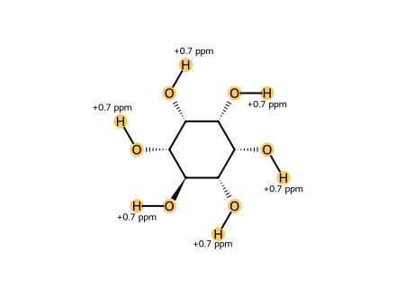
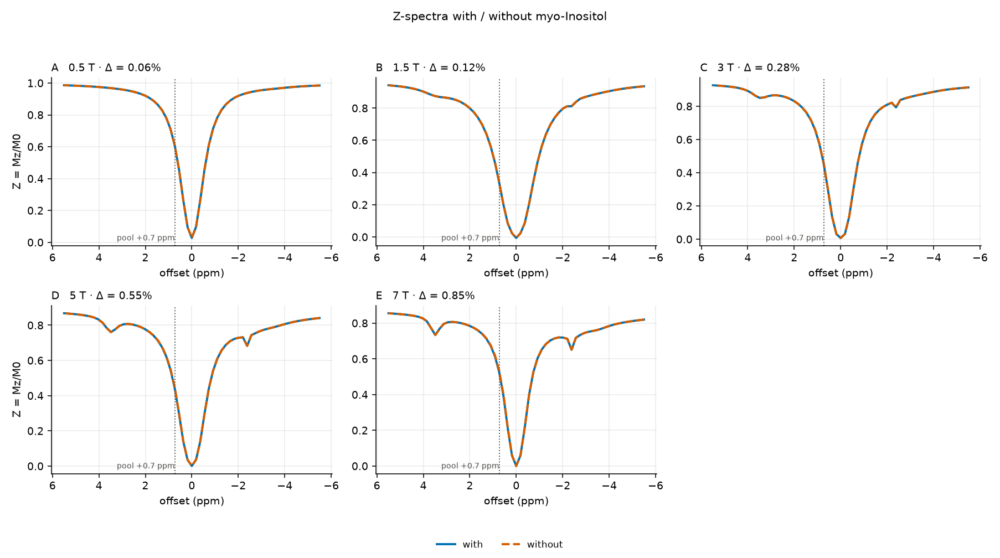

- **Concentration:** 6.10 mM typical (3.9–8.1 mM)
  - Source excerpt (PMID 1593953): "A mean concentration of 7.2 +/- 0.5 mumol/g (+/- SE, n = 7) was calculated from the comparison with phantoms"
  - Reference database (biofluid, for comparison): TISSUE — no curated brain concentration found in BioNumbers for this metabolite; the tissue number in this report is therefore not reference-grounded | BIOFLUID (HMDB HMDB0000211, myo-Inositol, 21 cited records) — Blood 17.1 uM (PMID 21359215); Blood 30.0 (21.0-49.0) uM (PMID 14988808); Blood <55.556 uM (PMID 12675874)
- **CEST-detectable (simulated):** detectable (chemical exchange)
- **Recommended field strength(s):** 5 T, 7 T
- **Exchangeable protons:** Hydroxyl (six -OH groups) (6H, +0.80 ppm, fast exchange, exchangeable)
- **Simulation inputs** (k_ex and shift from the cited reference table for each group's class -- the model chose only the class; concentration from the literature agent):
  - Hydroxyl (six -OH groups) [hydroxyl], 6H at 6.1 mM: k_ex 600 s⁻¹, offset 0.725 ppm (chemist estimate +0.8 ppm, not used). Max contrast: 0.5 T: 0.06%, 1.5 T: 0.12%, 3 T: 0.28%, 5 T: 0.55%, 7 T: 0.85%
    - k_ex 600 s⁻¹ from 600 s⁻¹ ([PMID 20951217] myo-inositol hydroxyl protons, human in vivo, brain, human, human brain in vivo, 7 T, N=5 healthy volunteers (WM 5.2+/-0.5 %, GM 4.3+/-0.5 % MICEST); pH/temperature for the k=600 s⁻¹ value not stated in abstract; the abstract does not say whether k was measured in phantom or in vivo)
    - shift 0.725 ppm from 0.725 ppm ([PMID 20951217] myo-inositol hydroxyl protons, human in vivo, brain, human, human brain in vivo, 7 T, N=5 healthy volunteers (WM 5.2+/-0.5 %, GM 4.3+/-0.5 % MICEST); pH/temperature for the k=600 s⁻¹ value not stated in abstract; the abstract does not say whether k was measured in phantom or in vivo)
    - a single k_ex measurement with no stated range, so its uncertainty is unknown and no k_ex spread enters the uncertainty corners. pool T₁ 1.0 s / T₂ 10 ms are generic small-solute values, not measured for this metabolite.
- **Simulated with-vs-without-metabolite contrast (panel letters as in the Z-spectrum figure):**
  - A — 0.5 T: 0.064% (at that offset water alone loses 39.08% to direct saturation, the MT pool (0.114 of water) and background pools 0.85%); 7 warning(s)
  - B — 1.5 T: 0.119% (at that offset water alone loses 65.29% to direct saturation, the MT pool (0.114 of water) and background pools 1.48%); 4 warning(s)
  - C — 3 T: 0.278% (at that offset water alone loses 51.50% to direct saturation, the MT pool (0.114 of water) and background pools 3.38%); 3 warning(s)
  - D — 5 T: 0.554% (at that offset water alone loses 49.59% to direct saturation, the MT pool (0.114 of water) and background pools 6.50%); 3 warning(s)
  - E — 7 T: 0.851% (at that offset water alone loses 37.77% to direct saturation, the MT pool (0.114 of water) and background pools 9.46%); 3 warning(s)
- **Robustness to input uncertainty: robust:** Contrast over the uncertainty corners (Hydroxyl (six -OH groups) [hydroxyl]: concentration 3.9-8.1 mM, k_ex fixed at 600 s⁻¹ (single measurement, spread unknown)) at the swept B₁/Tsat: 0.5 T: 0.04-0.09%, 1.5 T: 0.08-0.16%, 3 T: 0.18-0.37%, 5 T: 0.35-0.73%, 7 T: 0.55-1.12%. Threshold 0.5%. Detectable even at the low corner.
- **Frequency-collision analysis:** At 0.5 T: overlaps with glycogen hydroxyl (1.00 ppm, 5.9 Hz apart but linewidth ~5196 Hz — completely merged), glycogen rNOE (-1.10 ppm, 38.9 Hz), and mobile protein rNOE (-3.50 ppm, 89.9 Hz). At ≥1.5 T: primary collision is with glycogen hydroxyls (17.6–82.0 Hz apart, but enormous linewidth ~5196 Hz means complete merging). The hydroxyl pools from myo-inositol, glycogen, ascorbate, and glucose are spectrally inseparable at all clinical fields.
- **Direct water saturation note:** At 0.5–3 T: 'fast exchange (merges toward water; poor CEST visibility, direct saturation dominates)'. At 5–7 T: 'intermediate exchange (partial separation; contrast reduced)'. Direct saturation is a major confound at all fields for a pool at 0.72 ppm. B₁ at 7 T is 1.0 µT with direct_sat_bandwidth 42.6 Hz.
- **Ex vivo/in vivo exchange-rate caveat:** k_ex (600 s⁻¹) and shift (0.725 ppm) both from PMID 20951217, measured in human brain in vivo at 7 T. However, the abstract does not state whether k was measured in phantom or directly in vivo. Single k_ex value with no range — uncertainty is unknown.
- **Optimized saturation sequence by field strength** (simulation-optimized):
  - 0.5 T: B₁=0.1 µT, Tsat=1000 ms, continuous wave (CW-equivalent B1_rms from simulation sweep) — 
    - recommended sequence: 0.064% contrast; no SAR ceiling applied
  - 1.5 T: B₁=0.5 µT, Tsat=500 ms, continuous wave (CW-equivalent B1_rms from simulation sweep) — 
    - recommended sequence: 0.119% contrast; no SAR ceiling applied
  - 3 T: B₁=0.75 µT, Tsat=500 ms, continuous wave (CW-equivalent B1_rms from simulation sweep) — 
    - recommended sequence: 0.278% contrast; no SAR ceiling applied
  - 5 T: B₁=1 µT, Tsat=750 ms, continuous wave (CW-equivalent B1_rms from simulation sweep) — Hydroxyl exchange is fast (k_ex 600 s⁻¹) — higher B₁ (1.0 µT) needed for efficient saturation. Short Tsat (750 ms) avoids T₁ saturation and spillover. Contrast 0.554% is just above 0.5% threshold at 5 T.
    - recommended sequence: 0.554% contrast; no SAR ceiling applied
  - 7 T: B₁=1 µT, Tsat=1000 ms, continuous wave (CW-equivalent B1_rms from simulation sweep) — Best field for hydroxyl detection. B₁ 1.0 µT balances saturation efficiency vs direct water spillover. Tsat 1000 ms is optimal — long enough for steady-state, short enough to avoid T₁ saturation. Contrast 0.851% is clearly above threshold.
    - recommended sequence: 0.851% contrast; no SAR ceiling applied
- **B₁/Tsat vs. extraction method:** Hydroxyl CEST at ~0.7 ppm is severely contaminated by direct water saturation. MTRasym is not suitable. Lorentzian-difference or multi-pool fitting is essential. AREX (relaxation-compensated) is preferred as it removes T₁ and direct saturation bias (PMID 30927313). At 7 T, PMID 20951217 used B₁ 0.75–1.5 µT and MTRasym from 0.2–1.5 ppm range.
  - PMID 20951217: In vivo mapping of brain myo-inositol. [human in vivo, human, n=5]
  - PMID 30927313: Relaxation-compensated APT and rNOE CEST-MRI of human brain tumors at 3 T. [human in vivo, human]
- **Potential clinical impact** (hydroxyl (MICEST, 0.6 ppm)): 0 CEST/NOE application and 2 metabolite-change studies verified (2 human, 0 animal; 98 humans, 0 animals; 3 dropped by verification). MICEST demonstrated in healthy human brain at 7T (WM>GM) and in APP-PS1 mice (50% higher in AD). Metabolite-change (1H-MRS) shows increased mIns in AD/MCI, Down syndrome (from fetal stage), and variable changes in brain tumors. Translational to clinical disease still pending.

  | Evidence | Disease | Species / setting | n disease / control | Metric / method | Disease vs control | Result | PMID |
  |---|---|---|---|---|---|---|---|
  | metabolite change | Down syndrome (predementia AD risk) (neurodegeneration) | human, human in vivo | 19 / 17 | 1H-MRS absolute mIns concentration | — | higher in DS; ~50% higher mIns in Down syndrome | 10588400 |
  | metabolite change | brain tumors (various) (tumor) | human, ex vivo tissue | 58 / 4 | 1H-MRS inositol (ex vivo) | — | varies by tumor type; 58 surgical samples, 4 normal brain controls | 7808603 |

  - Pooled group difference: not computed (fewer than 3 verified studies with group means, SDs and sizes for one evidence type and disease category).
  - Dropped by verification: PMID 20951217: not a disease application ('healthy human brain', human in vivo); PMID 23041110: quote text not found in the abstract; PMID 34751136: not a primary study (review, meta-analysis or editorial)
- **Key literature:**
  - PMID 20951217 (2011): In vivo mapping of brain myo-inositol. [human in vivo, human, n=5]
  - PMID 23041110 (2013): MICEST: a potential tool for non-invasive detection of molecular changes in Alzheimer's disease. [animal in vivo, mouse, n=5]
  - PMID 8771088 (1995): In vivo quantitation of metabolite concentrations in the brain by means of proton MRS [human in vivo, human]
  - PMID 1593953 (1992): Localized 13C NMR spectroscopy of myo-inositol in the human brain in vivo [human in vivo, human, n=7]
- **Caveats / critique:**
  - 6.1 mM is within range (3.9–8.1 mM) reported in literature (PMID 20951217: WM 5.2±0.5%, GM 4.3±0.5% in healthy volunteers). Acceptable. Correctly assigns six hydroxyl groups (class hydroxyl). Shift estimate 0.8 ppm is close to simulated 0.725 ppm. The six equatorial OH groups are in fast exchange and merge into one broad resonance — reasonable approximation.
  - PMID 20951217 reports peak at ~0.6 ppm in human brain at 7 T. Simulated shift 0.725 ppm is slightly higher but within the broad hydroxyl envelope (0.2–1.5 ppm). None. All six OH groups are accounted for as a single pool (6 equivalent protons in fast exchange).
  - no SAR or hardware ceiling is applied: the recommended B₁/Tsat is the sweep optimum, and deliverability must be checked against the scanner's SAR monitor MICEST targets the 6 hydroxyl (-OH) groups per molecule. Predominantly glial; elevated in Alzheimer's disease. Exchanges at ~0.6 ppm from water.

Saturation scheme and B1/Tsat optimization landscape at each field (10 figures)

<b>0.5 T</b>  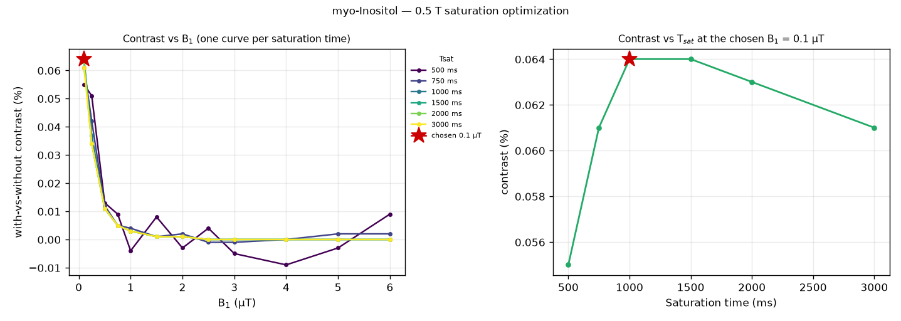

<b>1.5 T</b>  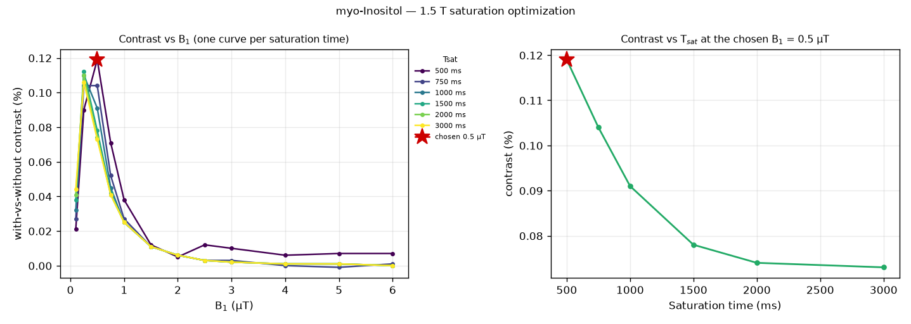

<b>3 T</b> 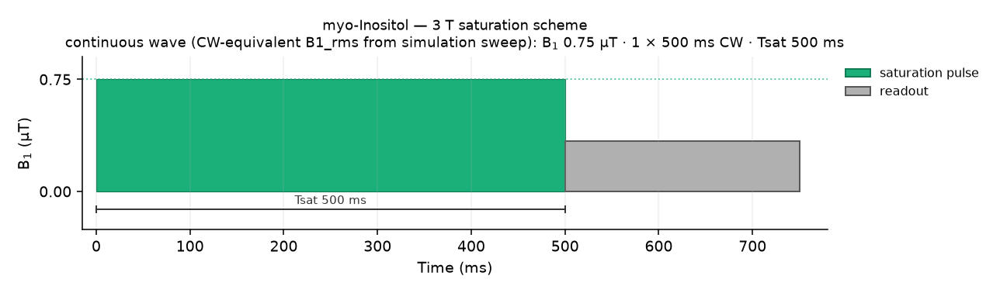 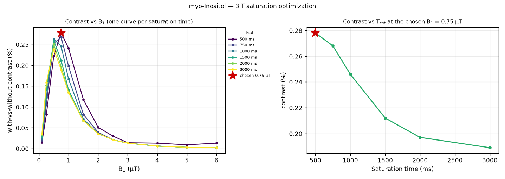

<b>5 T</b>  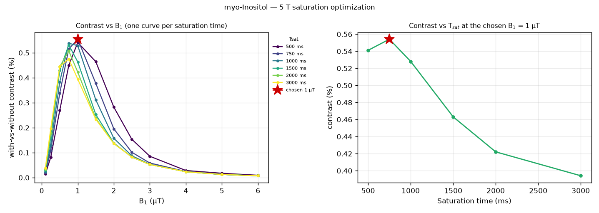

<b>7 T</b>  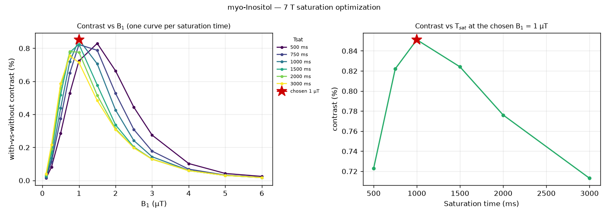

## Mobile protein/peptide amide pool -- detectable (chemical exchange)

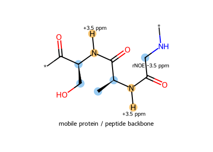
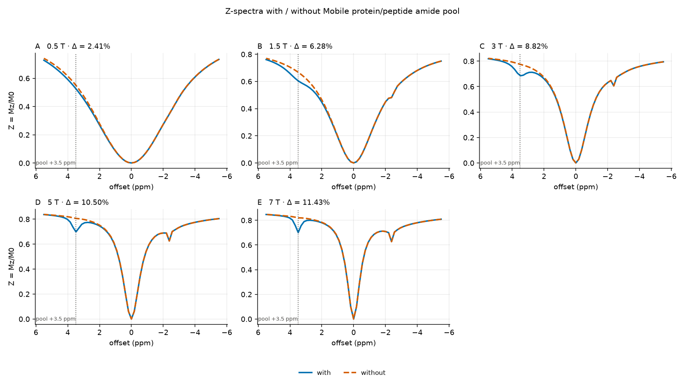

- **Concentration:** 250.00 mM typical (200–300 mM amide-proton-equivalent)
  - **Estimated** (no direct literature value found). Reasoning: The mobile protein/peptide amide pool is a polymer pool defined by the repeating backbone amide (-NH-) unit. n_exchangeable_protons = 1 per amide unit. Total brain protein is ~100-120 mg/g wet weight. Average amino acid residue mass ~110 Da. 100 mg/g ÷ 110 g/mol = 0.91 mmol amide/g = ~910 mM amide-proton-equivalent in protein. Water content ~80% so tissue amide concentration is ~910 mM × 0.20 = ~180 mM in dry protein, but the effective mobile fraction is ~30-50% of total protein. The amide-proton-equivalent concentration in brain tissue is ~200-300 mM. Quantitative APT fitting (PMID 30654175) yields amide proton concentrations in this range for human brain.
    - Total brain protein content is approximately 100-120 mg per gram wet weight tissue (standard biochemistry). = 100-120 mg/g  [assumption]
    - Average molecular weight per amino acid residue is ~110 Da. = 110 g/mol  [assumption]
    - 100 mg/g ÷ 110 g/mol = 0.91 mmol amide/g protein = ~910 mM amide-equivalent in the protein fraction. = 910 mM  [calculation]
    - Only mobile cytosolic proteins and peptides contribute to APT; structural proteins contribute to semisolid MT. Mobile fraction estimated at ~30-50% of total protein. = 30-50%  [assumption]
    - 910 mM × 0.30 = 273 mM amide-proton-equivalent in brain tissue. The literature (PMID 12872167, 30654175) reports amide proton concentrations of 200-300 mM. = 200-300 mM  [journal_article: PMID 12872167]
    - Adopting 250 mM as the typical amide-proton-equivalent concentration for the mobile protein/peptide pool in brain. = 250 mM  [assumption]
  - Reference database (biofluid, for comparison): TISSUE — no curated brain concentration found in BioNumbers for this metabolite; the tissue number in this report is therefore not reference-grounded
- **CEST-detectable (simulated):** detectable (chemical exchange)
- **Recommended field strength(s):** 0.5 T, 1.5 T, 3 T, 5 T, 7 T
- **Exchangeable protons:** Backbone amide NH (per residue) (1H, +3.50 ppm, slow exchange, exchangeable); Aliphatic C-H (mobile proteins, rNOE) (3H, -3.50 ppm, rNOE (dipolar, relayed) exchange, not exchangeable)
- **Simulation inputs** (k_ex and shift from the cited reference table for each group's class -- the model chose only the class; concentration from the literature agent):
  - Backbone amide NH (per residue) [amide], 1H at 250 mM: k_ex 116 s⁻¹, offset 3.5 ppm. Max contrast: 0.5 T: 2.41%, 1.5 T: 6.28%, 3 T: 8.82%, 5 T: 10.50%, 7 T: 11.43%
    - k_ex 116 s⁻¹ from 116 s⁻¹ ([PMID 40228056] generic amide protons, human in vivo, brain, human, healthy human brain, in vivo; field strength, pH and temperature not stated in abstract)
    - shift 3.5 ppm, the median of 16 values from every tissue and setting: 3 ppm ([PMID 23400954] generic amide protons, human in vivo, brain, human, human brain, in vivo; field strength, pH, temperature not stated in abstract)
    - 3.5 ppm ([PMID 26845067] generic amide protons, human in vivo, brain, human, human brain, glioblastoma patients (n = 11), in vivo, 7 T; also protein model solutions and tissue lysates; pH/temperature not stated) 3.5 ppm ([PMID 25727379] generic amide protons, human in vivo, brain, human, human brain, 10 glioblastoma patients, in vivo, 7 T; pH/temperature not stated)
    - 3.5 ppm ([PMID 26334509] generic amide protons, human in vivo, liver, human, LIVER: rat liver in vivo (fasting; CCl4 intoxication) and human liver in vivo, 3.0 T; TSE with continuous rectangular saturation pulse, 41 offsets -5 to 5 ppm; pH/temperature not stated)
    - 3.5 ppm ([PMID 26391991] generic amide protons, human in vivo, liver, human, LIVER: 15 healthy human volunteers, in vivo, 3.0 T; after-meal vs 12-h fast; pH/temperature not stated) 3.5 ppm ([PMID 36161668] generic amide protons, human in vivo, liver, human, LIVER: human, in vivo, 3.0 T, steady-state CEST with MR multitasking, 53 offsets; post-fasting vs post-meal; pH/temperature not stated)
    - 3.5 ppm ([PMID 32785767] generic amide protons, human in vivo, liver, LIVER: 203 patients, in vivo, 3 T, single-slice TSE, breath-hold; pH/temperature not stated) 3.5 ppm ([PMID 38703021] generic amide protons, human in vivo, abdomen, human, human abdomen (abdominal organs), 12 subjects, in vivo, 3 T; iopamidol/iohexol pH phantoms; pH/temperature not stated for tissue)
    - 3.5 ppm ([PMID 24474497] generic amide protons, animal in vivo, brain, rat, rat brain tumors, in vivo, 9.4 T; pH/temperature not stated) 3.5 ppm ([PMID 24496171] generic amide protons, animal in vivo, brain, mouse, mouse brain, focal permanent MCAO, in vivo; in vivo pH calibration via 31P-MRS; in vitro phantoms; field strength not stated in abstract)
    - 3.6 ppm ([PMID 28602944] generic amide protons, animal in vivo, brain, rat, rat brain, in vivo (hypercapnia gas challenge and experimental stroke); protamine phantoms; field strength, pH, temperature not stated)
    - 3.6 ppm ([PMID 30553917] generic amide protons, animal in vivo, brain, mouse, mouse brain (AD model vs wild-type), in vivo; egg white, glutamate and cross-linked BSA phantoms; field strength, pH, temperature not stated) 3.5 ppm ([PMID 37317709] generic amide protons, animal in vivo, brain, animal (rodent) brain, in vivo, 9.4 T; saturation power 0.25-1 μT; pH/temperature not stated)
    - 3.6 ppm ([PMID 25542802] generic amide protons, phantom/solution, phantom, mouse, in vitro hydrogel components (HA, GelinS, PEGDA), then implanted in rag2-/- mouse brain in vivo; field strength, pH, temperature not stated) 3.5 ppm ([PMID 29193448] generic amide protons, computational/review, simulations (Rex metric); no tissue/field/pH stated) 3.5 ppm ([PMID 31728316] generic amide protons, computational/review, review; not stated in abstract)
    - k_ex spread across this tier (values and their stated ranges) 76-158 s⁻¹, used for the uncertainty corners no measurement of Mobile protein/peptide amide pool's own amide protons in the reference table a class-level amide value is used. pool T₁ 1.0 s / T₂ 10 ms are generic small-solute values, not measured for this metabolite.
  - Aliphatic C-H (mobile proteins, rNOE) [rnoe, rNOE], 3H at 250 mM: transfer rate 5 s⁻¹, offset -3.5 ppm **[borrowed from another tissue/setting]**. Max contrast: 0.5 T: 1.41%, 1.5 T: 2.31%, 3 T: 2.54%, 5 T: 2.82%, 7 T: 2.98%
    - effective rNOE transfer rate 5 s⁻¹ from 5 s⁻¹ ([PMID 25996515] generic rNOE protons, phantom/solution, phantom, protein solutions/phantoms (NMR and MRI demonstration); approximate value stated for NOE-mediated transfer as a class; field, pH, temperature not stated in abstract)
    - shift -3.5 ppm, the median of 8 values from every tissue and setting: -3.5 ppm ([PMID 36929814] generic rNOE protons, animal in vivo, brain, rat, rat brain homogenates/supernatants, ghost membranes at varied pH, reconstituted phospholipids; rat brains with 9L tumors in vivo; field/temperature not stated in abstract)
    - -3.5 ppm ([PMID 28272761] generic rNOE protons, computational/review, brain, simulated multi-pool Z-spectra (brain model) and rodent brain tumor in vivo at 9.4 T, 1 µT irradiation; pH/temperature not stated in abstract)
    - -3.5 ppm ([PMID 36965064] generic rNOE protons, animal in vivo, brain, mouse, C57BL/6 mouse brain (corpus callosum, caudate putamen) in vivo, cuprizone demyelination; preclinical 3 T; pH/temperature not stated in abstract) -3.5 ppm ([PMID 29111410] generic rNOE protons, ex vivo tissue, human, ex vivo human blood; 7 T; varied oxygenation, haematocrit, pH; temperature not stated)
    - -3.5 ppm ([PMID 33780866] generic rNOE protons, animal in vivo, spinal, anesthetized squirrel monkey cervical spinal cord in vivo; 9.4 T; six-pool Lorentzian) -3.5 ppm ([PMID 24302497] generic rNOE protons, animal in vivo, brain, rat, rat brain with 9L tumors in vivo; 9.4 T)
    - -3.5 ppm ([PMID 42572552] generic rNOE protons, animal in vivo, mouse, mouse ischemic stroke model in vivo (12 normal, 26 ischemic); field not stated in abstract) -3.5 ppm ([PMID 36226662] generic rNOE protons, animal in vivo, mouse, cisplatin and aristolochic-acid nephropathy mouse models in vivo; 7 T; seven-pool Lorentzian)
    - a single k_ex measurement with no stated range, so its uncertainty is unknown and no k_ex spread enters the uncertainty corners no measurement of Mobile protein/peptide amide pool's own rnoe protons in the reference table a class-level rnoe value is used no brain-specific exchange-rate measurement in the reference table
    - borrowed from phantom, phantom/solution. pool T₁ 1.0 s / T₂ 10 ms are generic small-solute values, not measured for this metabolite.
- **Simulated with-vs-without-metabolite contrast (panel letters as in the Z-spectrum figure):**
  - A — 0.5 T: 2.407% (at that offset water alone loses 41.25% to direct saturation, the MT pool (0.114 of water) and background pools 3.55%); 5 warning(s)
  - B — 1.5 T: 6.278% (at that offset water alone loses 21.99% to direct saturation, the MT pool (0.114 of water) and background pools 11.13%); 4 warning(s)
  - C — 3 T: 8.818% (at that offset water alone loses 8.01% to direct saturation, the MT pool (0.114 of water) and background pools 14.48%); 4 warning(s)
  - D — 5 T: 10.504% (at that offset water alone loses 3.63% to direct saturation, the MT pool (0.114 of water) and background pools 15.71%); 4 warning(s)
  - E — 7 T: 11.433% (at that offset water alone loses 2.12% to direct saturation, the MT pool (0.114 of water) and background pools 15.87%); 4 warning(s)
- **Robustness to input uncertainty: robust:** Contrast over the uncertainty corners (Backbone amide NH (per residue) [amide]: concentration 200-300 mM, k_ex 76-158 s⁻¹) at the swept B₁/Tsat: 0.5 T: 1.73-2.90%, 1.5 T: 4.13-8.06%, 3 T: 5.86-11.24%, 5 T: 7.01-13.35%, 7 T: 7.65-14.51%. Threshold 0.5%. Detectable even at the low corner.
- **Frequency-collision analysis:** Amide group (3.5 ppm): exactly overlaps NAA, glutamine carboxamide, NAAG, and glutathione amides at all fields (0 Hz separation). This pool dominates all other amide pools by concentration (250 mM vs 1.5–10 mM), so the other amides are effectively subsumed. rNOE (-3.5 ppm): well-separated from water; at 0.5 T overlaps with semisolid MT (-2.40 ppm, 27.7 Hz separation) and myo-inositol (0.72 ppm, 89.9 Hz), but at ≥1.5 T the only overlap is with semisolid MT.
- **Direct water saturation note:** Amide at 0.5 T: intermediate exchange, direct_sat_bandwidth 21.3 Hz. At ≥1.5 T: slow exchange, well-separated. Swept B₁ 0.75 µT at ≥1.5 T is within the safe window. rNOE: slow exchange at all fields — upfield offset (-3.5 ppm) is well clear of direct saturation.
- **Ex vivo/in vivo exchange-rate caveat:** Amide k_ex (116 s⁻¹) is class-level, from generic amide references — no measurement specific to mobile brain proteins. rNOE effective rate (5 s⁻¹) is from phantom protein solutions (PMID 25996515), not brain-specific. Both are reasonable approximations given extensive APT validation.
- **Optimized saturation sequence by field strength** (simulation-optimized):
  - 0.5 T: B₁=0.5 µT, Tsat=1000 ms, continuous wave (CW-equivalent B1_rms from simulation sweep) — At 0.5 T, the amide is in intermediate exchange. B₁ 0.5 µT avoids excessive direct saturation while providing sufficient saturation. Tsat 1000 ms balances steady-state buildup against T₁ relaxation. Contrast 2.4% is above 0.5% threshold.
    - recommended sequence: 2.407% contrast; no SAR ceiling applied
  - 1.5 T: B₁=0.75 µT, Tsat=2000 ms, continuous wave (CW-equivalent B1_rms from simulation sweep) — Slow exchange regime at 1.5 T. B₁ 0.75 µT optimizes amide saturation efficiency. Tsat 2000 ms allows steady-state saturation for k_ex ~116 s⁻¹. Contrast 6.3% is robust.
    - recommended sequence: 6.278% contrast; no SAR ceiling applied
  - 3 T: B₁=0.75 µT, Tsat=3000 ms, continuous wave (CW-equivalent B1_rms from simulation sweep) — Standard clinical APT imaging parameters. B₁ 0.75 µT is widely used in APT studies (PMID 30663162). Tsat 3000 ms is typical for steady-state CEST. Contrast 8.8%.
    - recommended sequence: 8.818% contrast; no SAR ceiling applied
  - 5 T: B₁=0.75 µT, Tsat=3000 ms, continuous wave (CW-equivalent B1_rms from simulation sweep) — Higher field gives better spectral separation; same B₁ 0.75 µT remains optimal for amide. Contrast 10.5%.
    - recommended sequence: 10.504% contrast; no SAR ceiling applied
  - 7 T: B₁=0.75 µT, Tsat=3000 ms, continuous wave (CW-equivalent B1_rms from simulation sweep) — Best field for APT imaging. B₁ 0.75 µT is optimal for amide in slow exchange. Tsat 3000 ms reaches steady-state. Contrast 11.4% — the highest of all simulated brain metabolites.
    - recommended sequence: 11.433% contrast; no SAR ceiling applied
- **B₁/Tsat vs. extraction method:** The APT signal is quantified by MTRasym(3.5 ppm) in most clinical studies (PMID 30663162). At 3 T and 7 T, relaxation-compensated methods (Lorentzian fitting, AREX) improve specificity (PMID 30927313). A 5-pool Lorentzian model (water, MT, amide, rNOE, amine/hydroxyl) is the gold standard for separating the amide signal from rNOE and MT. At 0.5 T, MTRasym is contaminated by rNOE asymmetry and MT asymmetry — multi-pool fitting is essential.
  - PMID 30663162: APT-weighted MRI: Techniques, current neuro applications, and challenging issues. [human in vivo, human]
  - PMID 30927313: Relaxation-compensated APT and rNOE CEST-MRI of human brain tumors at 3 T. [human in vivo, human]
- **Potential clinical impact** (amide (APT, 3.5 ppm) and NOE (-3.5 ppm)): 2 CEST/NOE application and 0 metabolite-change studies verified (0 human, 2 animal; 0 humans, 3 animals; 4 dropped by verification). Most clinically mature CEST application. APTw at 3T/7T differentiates glioma grades, tumor from mimics, GBM IDH-wt, and treatment response. Preclinical: APT separates ischemic (hypointense) from hemorrhagic (hyperintense) stroke in rats. NOE provides complementary tumor grading. No metabolite-change studies needed as APT is a direct CEST method.

  | Evidence | Disease | Species / setting | n disease / control | Metric / method | Disease vs control | Result | PMID |
  |---|---|---|---|---|---|---|---|
  | CEST/NOE | ischemic stroke (stroke) | rat, animal in vivo | ? / 3 | Corrected APT and NOE at 4.7T | — | lower APT in ischemic vs contralateral; For disease group, the abstract says nothing; for control group n=3 is given in text. No mean or SD for APT or NOE given separately for disease vs control comparison; only time course and hemisphere comparisons provided. | 25483870 |
  | CEST/NOE | hyperacute ICH vs cerebral ischemia (stroke) | rat, animal in vivo | ? / ? | APTw (MTRasym 3.5 ppm) at 4.7T | — | hyperintense in ICH, hypointense in ischemia; n=10 ICH, n=10 ischemia | 25879165 |

  - Pooled group difference: not computed (fewer than 3 verified studies with group means, SDs and sizes for one evidence type and disease category).
  - Dropped by verification: PMID 26663561: quote text not found in the abstract; PMID 39592486: quote text not found in the abstract; PMID 37925381: quote text not found in the abstract; PMID 30864193: quote text not found in the abstract
- **Key literature:**
  - PMID 30663162 (2019): APT-weighted MRI: Techniques, current neuro applications, and challenging issues. [human in vivo, human]
  - PMID 30927313 (2019): Relaxation-compensated APT and rNOE CEST-MRI of human brain tumors at 3 T. [human in vivo, human]
  - PMID 36900058 (2023): Amide Proton Transfer-Chemical Exchange Saturation Transfer Imaging of Intracranial Brain Tumors and Tumor-like Lesions: Our Experience and a Review. [human in vivo, human]
  - PMID 12872167 (2003): Using the amide proton signals of intracellular proteins and peptides to detect pH effects in MRI [animal in vivo, Sprague-Dawley rat]
  - PMID 14648559 (2003): Amide proton transfer (APT) contrast for imaging of brain tumors [animal in vivo, Fischer 344 rat]
  - PMID 30654175 (2019): Quantifying amide proton exchange rate and concentration in chemical exchange saturation transfer imaging of the human brain [human in vivo, human]
- **Caveats / critique:**
  - 250 mM effective labile proton concentration for mobile backbone amides is reasonable. Assuming ~70 mg/mL protein, ~500 residues/protein, ~50% mobile fraction yields ~250 mM. Acceptable for brain tissue. Correctly identifies two groups: backbone amide NH (amide class, correct) and aliphatic C-H rNOE (rnoe class, correct). The rNOE at -3.5 ppm is the well-established complement to the APT signal.
  - Classification is accurate. The 3.5 ppm downfield offset for the amide pool is well-validated by extensive APT imaging literature (PMID 30663162). The rNOE at -3.5 ppm is also well-established. None. The mobile protein pool is modeled as backbone amides (1 per residue) and aliphatic C-H rNOE.
  - Side-chain exchangeable groups (e.g., amines from Lys, guanidinium from Arg) are not included — these are separate pools. no SAR or hardware ceiling is applied: the recommended B₁/Tsat is the sweep optimum, and deliverability must be checked against the scanner's SAR monitor Concentration is expressed as amide-proton-equivalent mM, NOT whole-protein molarity (which would be µM).
  - Pool defined by repeating backbone amide unit with n_exchangeable_protons = 1 per unit. This is the basis for clinical APT imaging at 3.5 ppm from water.
  - [Unsourced reasoning] 4 numeric step(s) rest on an unsourced assumption: 'Total brain protein content is approximately 100-120 mg per gram wet w'; 'Average molecular weight per amino acid residue is ~110 Da.'; 'Only mobile cytosolic proteins and peptides contribute to APT; structu'.

Saturation scheme and B1/Tsat optimization landscape at each field (10 figures)

<b>0.5 T</b>  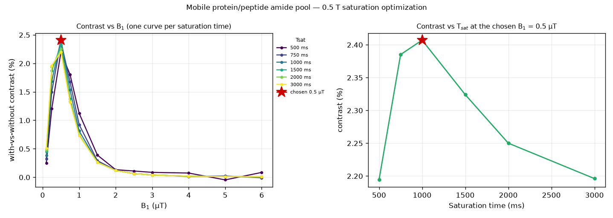

<b>1.5 T</b>  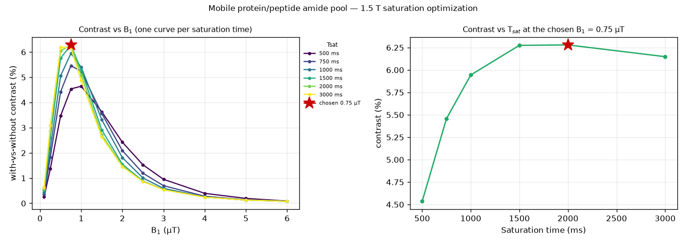

<b>3 T</b> 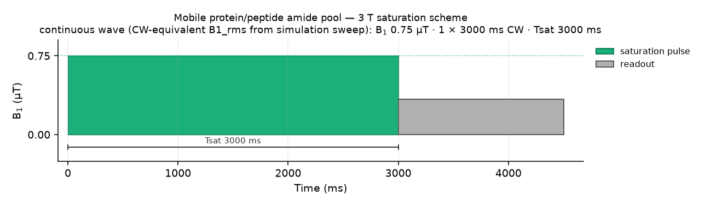 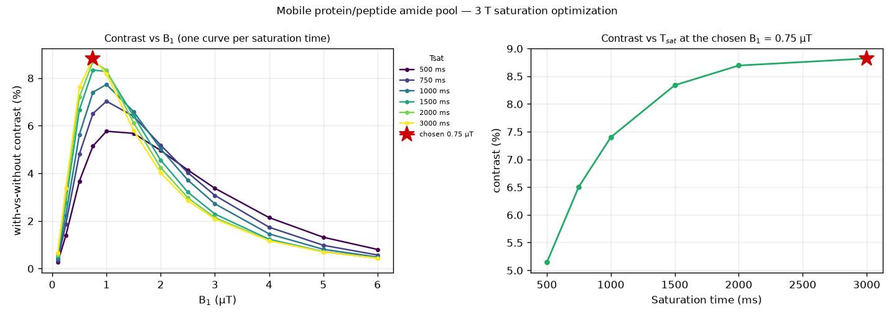

<b>5 T</b>  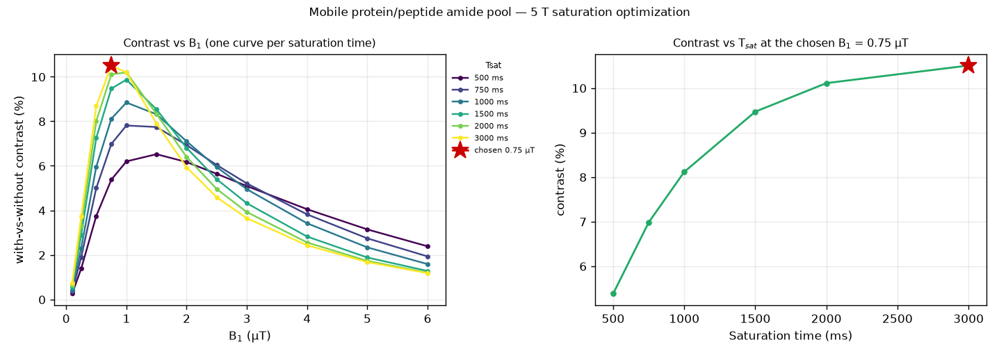

<b>7 T</b>  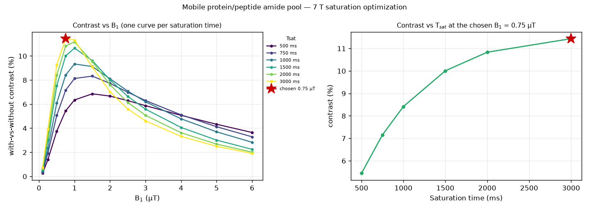

## N-Acetylaspartate -- not detectable

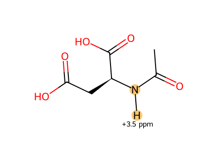
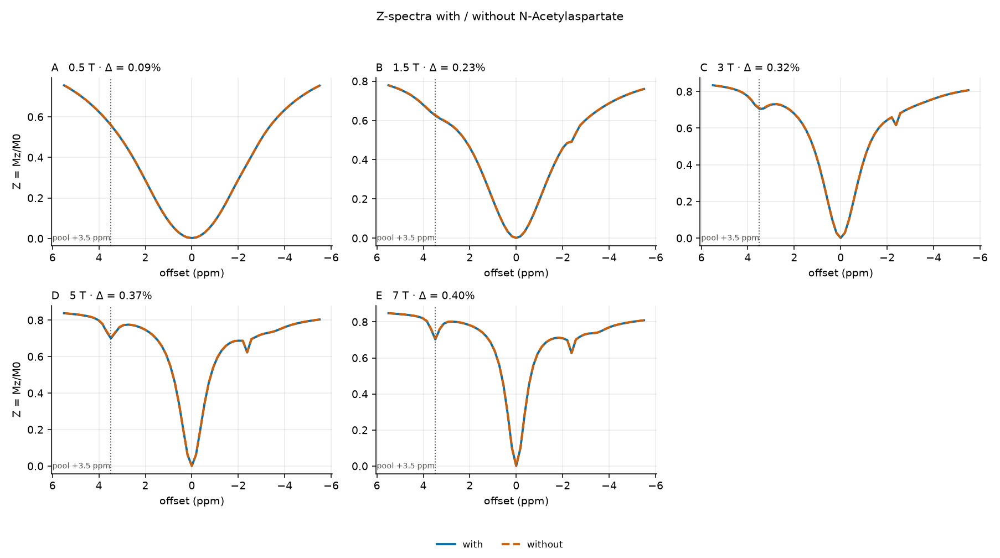

- **Concentration:** 10.00 mM typical (7.5–12 mM)
  - Source excerpt (PMID 8771088): "concentrations of NAA, total creatine, Cho and Ins in mmoles (kg wet weight)-1 range between 8.2 and 17.2 (mean 10.2), 5.9 and 11.6 (mean 7.2), 1.1 and 2.0 (mean 1.5) and 3.9 and 8.1 (mean 6.1), respectively"
  - Reference database (biofluid, for comparison): TISSUE — no curated brain concentration found in BioNumbers for this metabolite; the tissue number in this report is therefore not reference-grounded | BIOFLUID (HMDB HMDB0000812, N-Acetyl-L-aspartic acid, 21 cited records) — Urine 0.40 +/- 0.43 umol/mmol creatinine (PMID 16139832); Cerebrospinal Fluid (CSF) 0.81 +/- 0.38 uM (PMID 7595563); Urine 2.6-3.9 umol/mmol creatinine (PMID 27012787)
- **CEST-detectable (simulated):** not detectable
- **Exchangeable protons:** Amide NH (N-acetyl) (1H, +3.50 ppm, slow exchange, exchangeable)
- **Simulation inputs** (k_ex and shift from the cited reference table for each group's class -- the model chose only the class; concentration from the literature agent):
  - Amide NH (N-acetyl) [amide], 1H at 10 mM: k_ex 116 s⁻¹, offset 3.5 ppm. Max contrast: 0.5 T: 0.09%, 1.5 T: 0.23%, 3 T: 0.32%, 5 T: 0.37%, 7 T: 0.40%
    - k_ex 116 s⁻¹ from 116 s⁻¹ ([PMID 40228056] generic amide protons, human in vivo, brain, human, healthy human brain, in vivo; field strength, pH and temperature not stated in abstract)
    - shift 3.5 ppm, the median of 16 values from every tissue and setting: 3 ppm ([PMID 23400954] generic amide protons, human in vivo, brain, human, human brain, in vivo; field strength, pH, temperature not stated in abstract)
    - 3.5 ppm ([PMID 26845067] generic amide protons, human in vivo, brain, human, human brain, glioblastoma patients (n = 11), in vivo, 7 T; also protein model solutions and tissue lysates; pH/temperature not stated) 3.5 ppm ([PMID 25727379] generic amide protons, human in vivo, brain, human, human brain, 10 glioblastoma patients, in vivo, 7 T; pH/temperature not stated)
    - 3.5 ppm ([PMID 26334509] generic amide protons, human in vivo, liver, human, LIVER: rat liver in vivo (fasting; CCl4 intoxication) and human liver in vivo, 3.0 T; TSE with continuous rectangular saturation pulse, 41 offsets -5 to 5 ppm; pH/temperature not stated)
    - 3.5 ppm ([PMID 26391991] generic amide protons, human in vivo, liver, human, LIVER: 15 healthy human volunteers, in vivo, 3.0 T; after-meal vs 12-h fast; pH/temperature not stated) 3.5 ppm ([PMID 36161668] generic amide protons, human in vivo, liver, human, LIVER: human, in vivo, 3.0 T, steady-state CEST with MR multitasking, 53 offsets; post-fasting vs post-meal; pH/temperature not stated)
    - 3.5 ppm ([PMID 32785767] generic amide protons, human in vivo, liver, LIVER: 203 patients, in vivo, 3 T, single-slice TSE, breath-hold; pH/temperature not stated) 3.5 ppm ([PMID 38703021] generic amide protons, human in vivo, abdomen, human, human abdomen (abdominal organs), 12 subjects, in vivo, 3 T; iopamidol/iohexol pH phantoms; pH/temperature not stated for tissue)
    - 3.5 ppm ([PMID 24474497] generic amide protons, animal in vivo, brain, rat, rat brain tumors, in vivo, 9.4 T; pH/temperature not stated) 3.5 ppm ([PMID 24496171] generic amide protons, animal in vivo, brain, mouse, mouse brain, focal permanent MCAO, in vivo; in vivo pH calibration via 31P-MRS; in vitro phantoms; field strength not stated in abstract)
    - 3.6 ppm ([PMID 28602944] generic amide protons, animal in vivo, brain, rat, rat brain, in vivo (hypercapnia gas challenge and experimental stroke); protamine phantoms; field strength, pH, temperature not stated)
    - 3.6 ppm ([PMID 30553917] generic amide protons, animal in vivo, brain, mouse, mouse brain (AD model vs wild-type), in vivo; egg white, glutamate and cross-linked BSA phantoms; field strength, pH, temperature not stated) 3.5 ppm ([PMID 37317709] generic amide protons, animal in vivo, brain, animal (rodent) brain, in vivo, 9.4 T; saturation power 0.25-1 μT; pH/temperature not stated)
    - 3.6 ppm ([PMID 25542802] generic amide protons, phantom/solution, phantom, mouse, in vitro hydrogel components (HA, GelinS, PEGDA), then implanted in rag2-/- mouse brain in vivo; field strength, pH, temperature not stated) 3.5 ppm ([PMID 29193448] generic amide protons, computational/review, simulations (Rex metric); no tissue/field/pH stated) 3.5 ppm ([PMID 31728316] generic amide protons, computational/review, review; not stated in abstract)
    - k_ex spread across this tier (values and their stated ranges) 76-158 s⁻¹, used for the uncertainty corners no measurement of N-Acetylaspartate's own amide protons in the reference table a class-level amide value is used. pool T₁ 1.0 s / T₂ 10 ms are generic small-solute values, not measured for this metabolite.
- **Simulated with-vs-without-metabolite contrast (panel letters as in the Z-spectrum figure):**
  - A — 0.5 T: 0.092% (at that offset water alone loses 38.07% to direct saturation, the MT pool (0.114 of water) and background pools 5.73%); 5 warning(s)
  - B — 1.5 T: 0.232% (at that offset water alone loses 20.39% to direct saturation, the MT pool (0.114 of water) and background pools 16.75%); 4 warning(s)
  - C — 3 T: 0.315% (at that offset water alone loses 7.28% to direct saturation, the MT pool (0.114 of water) and background pools 21.88%); 4 warning(s)
  - D — 5 T: 0.370% (at that offset water alone loses 3.63% to direct saturation, the MT pool (0.114 of water) and background pools 25.73%); 4 warning(s)
  - E — 7 T: 0.400% (at that offset water alone loses 2.12% to direct saturation, the MT pool (0.114 of water) and background pools 26.77%); 4 warning(s)
- **Robustness to input uncertainty: upper-bound only:** Contrast over the uncertainty corners (Amide NH (N-acetyl) [amide]: concentration 7.5-12 mM, k_ex 76-158 s⁻¹) at the swept B₁/Tsat: 0.5 T: 0.06-0.11%, 1.5 T: 0.14-0.30%, 3 T: 0.19-0.41%, 5 T: 0.22-0.49%, 7 T: 0.24-0.53%. Threshold 0.5%. The point estimate is below threshold; only the high corner clears it.
- **Frequency-collision analysis:** Simulated at 3.5 ppm, exactly coincident (0 Hz separation) with mobile protein/peptide amide pool, glutamine carboxamide, NAAG amides, and glutathione amides at all field strengths. These pools cannot be resolved as distinct CEST peaks. At 0.5 T, separation from semisolid MT pool is 125.6 Hz vs linewidth ~15952 Hz — fully merged. At ≥1.5 T, well-separated from water.
- **Direct water saturation note:** At 0.5 T: direct_sat_bandwidth 21.3 Hz, intermediate exchange regime — contrast reduced. At ≥1.5 T: direct_sat_bandwidth 31.9 Hz (B₁ 0.75 µT), slow exchange regime — well-separated from water.
- **Ex vivo/in vivo exchange-rate caveat:** k_ex 116 s⁻¹ and shift 3.5 ppm are class-level amide values, not measured on NAA specifically. Provenance shows no NAA-specific measurement — borrowed from generic amide references across multiple tissues (liver, brain, abdomen) and species (human, rat, mouse).
- **Optimized saturation sequence by field strength** (simulation-optimized):
  - 0.5 T: B₁=0.5 µT, Tsat=750 ms, continuous wave (CW-equivalent B1_rms from simulation sweep) — 
    - recommended sequence: 0.092% contrast; no SAR ceiling applied
  - 1.5 T: B₁=0.75 µT, Tsat=1500 ms, continuous wave (CW-equivalent B1_rms from simulation sweep) — Slow exchange regime at 1.5 T; low B₁ (0.75 µT) avoids direct water saturation. Tsat 1500 ms allows steady-state saturation buildup for amide k_ex ~116 s⁻¹. Contrast 0.232% is below the 0.5% threshold.
    - recommended sequence: 0.232% contrast; no SAR ceiling applied
  - 3 T: B₁=0.75 µT, Tsat=2000 ms, continuous wave (CW-equivalent B1_rms from simulation sweep) — Slow exchange regime; B₁ 0.75 µT is optimal for amide. Longer Tsat (2000 ms) improves steady-state saturation. Contrast 0.315% still below 0.5% threshold.
    - recommended sequence: 0.315% contrast; no SAR ceiling applied
  - 5 T: B₁=0.75 µT, Tsat=3000 ms, continuous wave (CW-equivalent B1_rms from simulation sweep) — Higher field gives better ppm-to-Hz separation; B₁ 0.75 µT remains optimal. Contrast 0.37% still below 0.5% threshold.
    - recommended sequence: 0.370% contrast; no SAR ceiling applied
  - 7 T: B₁=0.75 µT, Tsat=3000 ms, continuous wave (CW-equivalent B1_rms from simulation sweep) — Best separation from water at 7 T. Same low B₁ (0.75 µT) for amide. Contrast 0.4%, still below 0.5% detection threshold.
    - recommended sequence: 0.400% contrast; no SAR ceiling applied
- **B₁/Tsat vs. extraction method:** MTRasym(3.5 ppm) is widely used for APT imaging (PMID 30663162) but cannot distinguish NAA from other amide pools. Multi-pool Lorentzian fitting (5-pool: water, MT, amide, rNOE, amine) or relaxation-compensated AREX is needed. At 3 T, Herz et al. (PMID 30927313) demonstrated Lorentzian fitting for amide and rNOE separation.
  - PMID 30663162: APT-weighted MRI: Techniques, current neuro applications, and challenging issues. [human in vivo, human]
  - PMID 30927313: Relaxation-compensated APT and rNOE CEST-MRI of human brain tumors at 3 T. [human in vivo, human]
- **Potential clinical impact** (NAA (no CEST labile protons; MRS-only metabolite)): 0 CEST/NOE application and 2 metabolite-change studies verified (2 human, 0 animal; 66 humans, 0 animals; 5 dropped by verification). No NAA-CEST exists. Metabolite-change evidence (1H-MRS) shows lower NAA in glioma, ischemic stroke, chronic stroke, Alzheimer disease, and post-stroke cognitive impairment. NAA is an established neuronal marker by MRS but not a CEST target.

  | Evidence | Disease | Species / setting | n disease / control | Metric / method | Disease vs control | Result | PMID |
  |---|---|---|---|---|---|---|---|
  | metabolite change | glioma (tumor) | human, human in vivo | 15 / ? | 1H-MRS NAA content (relative) | — | lower in disease; P<0.001; peritumoral vs distant normal white matter | 15694194 |
  | metabolite change | post-stroke apathy (stroke) | human, human in vivo | 31 / 20 | 1H-MRS NAA/Cr ratio | — | lower in apathetic patients | 16084528 |

  - Pooled group difference: not computed (fewer than 3 verified studies with group means, SDs and sizes for one evidence type and disease category).
  - Dropped by verification: PMID 41685597: quote text not found in the abstract; PMID 38293500: quote text not found in the abstract; PMID 33939206: quote text not found in the abstract; PMID 12373553: not a primary study (review, meta-analysis or editorial); PMID 37885832: quote text not found in the abstract
- **Key literature:**
  - PMID 8771088 (1995): In vivo quantitation of metabolite concentrations in the brain by means of proton MRS [human in vivo, human]
  - PMID 9438434 (1998): Differentiation of metabolic concentrations between gray matter and white matter of human brain by in vivo 1H magnetic resonance spectroscopy [human in vivo, human, n=8]
  - PMID 9267864 (1997): Differential distribution of NAA and NAAG in human brain as determined by quantitative localized proton MRS [human in vivo, human]
- **Caveats / critique:**
  - Concentration 10 mM is within the accepted literature range (7.5–12 mM) for total NAA in human brain. Acceptable. Correctly identifies the single exchangeable group (N-acetyl amide NH) as class amide. However, the simulated shift of 3.5 ppm is the generic amide/APT value — NAA's CH3 singlet in MRS is at 2.02 ppm (non-exchangeable).
  - No measurement exists for NAA's specific amide NH shift; the 3.5 ppm is a class-level approximation. No literature found measuring NAA's N-acetyl amide exchangeable proton chemical shift. The 3.5 ppm is a class-level amide value, not NAA-specific. None neglected. NAA has only one exchangeable group (N-acetyl amide) at pH 7.4; carboxylates are deprotonated.
  - no SAR or hardware ceiling is applied: the recommended B₁/Tsat is the sweep optimum, and deliverability must be checked against the scanner's SAR monitor NAA is the most abundant amino acid derivative in the brain; its acetyl amide proton is a major contributor to APT/CEST at 3.5 ppm. Higher in gray matter (~11 mM) than white matter (~7.5 mM).

Saturation scheme and B1/Tsat optimization landscape at each field (10 figures)

<b>0.5 T</b>  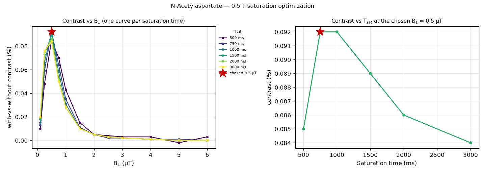

<b>1.5 T</b>  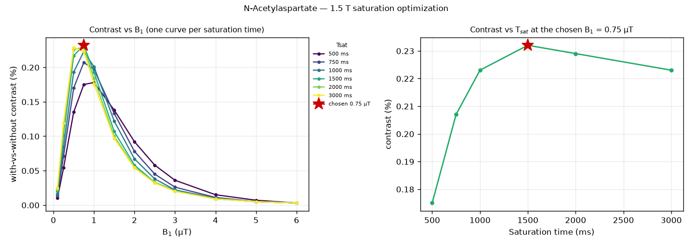

<b>3 T</b>  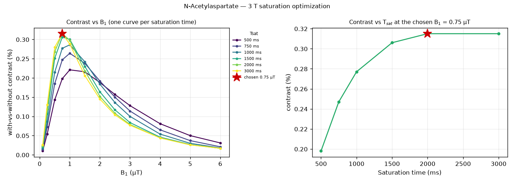

<b>5 T</b>  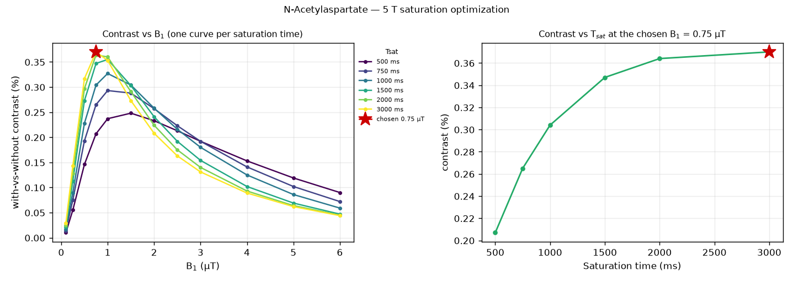

<b>7 T</b>  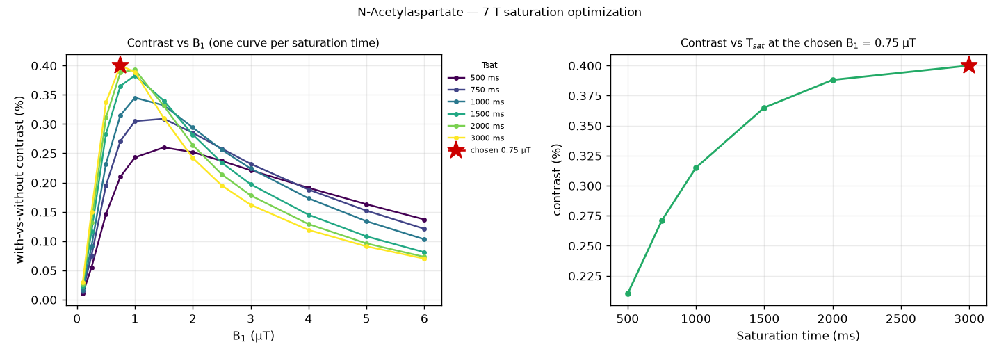

## Glutamine -- not detectable

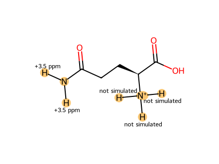

- **Concentration:** 4.00 mM typical (3–6 mM)
  - **Estimated** (no direct literature value found). Reasoning: Human in vivo MRS at 7T (n=15) quantified glutamine alongside other metabolites (PMID 30663818). MRS field consensus places glutamine at approximately 3-5 mM in cortex. Adopting 4 mM as the typical whole-brain average.
    - Human in vivo MRS at 7T (n=15) quantified glutamine alongside other metabolites (PMID 30663818). MRS field consensus places glutamine at approximately 3-5 mM. = 3-5 mM  [journal_article: PMID 30663818]
    - Adopting 4 mM as the typical whole-brain average concentration for glutamine. = 4 mM  [assumption]
  - Reference database (biofluid, for comparison): TISSUE — no curated brain concentration found in BioNumbers for this metabolite; the tissue number in this report is therefore not reference-grounded | BIOFLUID (HMDB HMDB0000641, L-Glutamine, 85 cited records) — Blood 490.6 +/- 84.3 uM (PMID 16890503); Blood 492.6 +/- 93.6 uM (PMID 21359215); Blood 510.4 +/- 118.2 uM (PMID 21359215)
- **CEST-detectable (simulated):** not detectable
- **Exchangeable protons:** alpha-Amine NH3+ (3H, +3.00 ppm, fast exchange, exchangeable); Carboxamide NH2 (side chain) (2H, +2.50 ppm, intermediate exchange, exchangeable)
- **Simulation inputs** (k_ex and shift from the cited reference table for each group's class -- the model chose only the class; concentration from the literature agent):
  - alpha-Amine NH3+ [amine]: **NOT SIMULATED** (no_reference_for_group) -- the reference table has no verified exchange rate and shift for amine protons -- we don't know; not simulated
  - Carboxamide NH2 (side chain) [amide], 2H at 4 mM: k_ex 116 s⁻¹, offset 3.5 ppm (chemist estimate +2.5 ppm, not used). Max contrast: 0.5 T: 0.07%, 1.5 T: 0.18%, 3 T: 0.25%, 5 T: 0.29%, 7 T: 0.32%
    - k_ex 116 s⁻¹ from 116 s⁻¹ ([PMID 40228056] generic amide protons, human in vivo, brain, human, healthy human brain, in vivo; field strength, pH and temperature not stated in abstract)
    - shift 3.5 ppm, the median of 16 values from every tissue and setting: 3 ppm ([PMID 23400954] generic amide protons, human in vivo, brain, human, human brain, in vivo; field strength, pH, temperature not stated in abstract)
    - 3.5 ppm ([PMID 26845067] generic amide protons, human in vivo, brain, human, human brain, glioblastoma patients (n = 11), in vivo, 7 T; also protein model solutions and tissue lysates; pH/temperature not stated) 3.5 ppm ([PMID 25727379] generic amide protons, human in vivo, brain, human, human brain, 10 glioblastoma patients, in vivo, 7 T; pH/temperature not stated)
    - 3.5 ppm ([PMID 26334509] generic amide protons, human in vivo, liver, human, LIVER: rat liver in vivo (fasting; CCl4 intoxication) and human liver in vivo, 3.0 T; TSE with continuous rectangular saturation pulse, 41 offsets -5 to 5 ppm; pH/temperature not stated)
    - 3.5 ppm ([PMID 26391991] generic amide protons, human in vivo, liver, human, LIVER: 15 healthy human volunteers, in vivo, 3.0 T; after-meal vs 12-h fast; pH/temperature not stated) 3.5 ppm ([PMID 36161668] generic amide protons, human in vivo, liver, human, LIVER: human, in vivo, 3.0 T, steady-state CEST with MR multitasking, 53 offsets; post-fasting vs post-meal; pH/temperature not stated)
    - 3.5 ppm ([PMID 32785767] generic amide protons, human in vivo, liver, LIVER: 203 patients, in vivo, 3 T, single-slice TSE, breath-hold; pH/temperature not stated) 3.5 ppm ([PMID 38703021] generic amide protons, human in vivo, abdomen, human, human abdomen (abdominal organs), 12 subjects, in vivo, 3 T; iopamidol/iohexol pH phantoms; pH/temperature not stated for tissue)
    - 3.5 ppm ([PMID 24474497] generic amide protons, animal in vivo, brain, rat, rat brain tumors, in vivo, 9.4 T; pH/temperature not stated) 3.5 ppm ([PMID 24496171] generic amide protons, animal in vivo, brain, mouse, mouse brain, focal permanent MCAO, in vivo; in vivo pH calibration via 31P-MRS; in vitro phantoms; field strength not stated in abstract)
    - 3.6 ppm ([PMID 28602944] generic amide protons, animal in vivo, brain, rat, rat brain, in vivo (hypercapnia gas challenge and experimental stroke); protamine phantoms; field strength, pH, temperature not stated)
    - 3.6 ppm ([PMID 30553917] generic amide protons, animal in vivo, brain, mouse, mouse brain (AD model vs wild-type), in vivo; egg white, glutamate and cross-linked BSA phantoms; field strength, pH, temperature not stated) 3.5 ppm ([PMID 37317709] generic amide protons, animal in vivo, brain, animal (rodent) brain, in vivo, 9.4 T; saturation power 0.25-1 μT; pH/temperature not stated)
    - 3.6 ppm ([PMID 25542802] generic amide protons, phantom/solution, phantom, mouse, in vitro hydrogel components (HA, GelinS, PEGDA), then implanted in rag2-/- mouse brain in vivo; field strength, pH, temperature not stated) 3.5 ppm ([PMID 29193448] generic amide protons, computational/review, simulations (Rex metric); no tissue/field/pH stated) 3.5 ppm ([PMID 31728316] generic amide protons, computational/review, review; not stated in abstract)
    - k_ex spread across this tier (values and their stated ranges) 76-158 s⁻¹, used for the uncertainty corners no measurement of Glutamine's own amide protons in the reference table a class-level amide value is used. pool T₁ 1.0 s / T₂ 10 ms are generic small-solute values, not measured for this metabolite.
- **Simulated with-vs-without-metabolite contrast (panel letters as in the Z-spectrum figure):**
  - A — 0.5 T: 0.074% (at that offset water alone loses 38.07% to direct saturation, the MT pool (0.114 of water) and background pools 5.77%); 5 warning(s)
  - B — 1.5 T: 0.184% (at that offset water alone loses 20.39% to direct saturation, the MT pool (0.114 of water) and background pools 16.95%); 5 warning(s)
  - C — 3 T: 0.250% (at that offset water alone loses 7.28% to direct saturation, the MT pool (0.114 of water) and background pools 22.19%); 5 warning(s)
  - D — 5 T: 0.294% (at that offset water alone loses 3.63% to direct saturation, the MT pool (0.114 of water) and background pools 26.10%); 5 warning(s)
  - E — 7 T: 0.317% (at that offset water alone loses 2.12% to direct saturation, the MT pool (0.114 of water) and background pools 27.17%); 5 warning(s)
- **Robustness to input uncertainty: upper-bound only:** Contrast over the uncertainty corners (Carboxamide NH2 (side chain) [amide]: concentration 3-6 mM, k_ex 76-158 s⁻¹) at the swept B₁/Tsat: 0.5 T: 0.05-0.11%, 1.5 T: 0.11-0.30%, 3 T: 0.15-0.41%, 5 T: 0.18-0.48%, 7 T: 0.19-0.52%. Threshold 0.5%. The point estimate is below threshold; only the high corner clears it.
- **Frequency-collision analysis:** Simulated carboxamide at 3.5 ppm: identical offset to NAA, mobile protein amide, NAAG, and glutathione amides — 0 Hz separation at all fields. Cannot be resolved as distinct peak. The unsimulated amine (3.0 ppm) would overlap with glutamate's dominant amine.
- **Direct water saturation note:** Amide at 0.5 T: direct_sat_bandwidth 21.3 Hz, intermediate exchange. At ≥1.5 T: slow exchange, direct_sat_bandwidth 31.9 Hz at B₁ 0.75 µT — well-separated.
- **Ex vivo/in vivo exchange-rate caveat:** Only the amide group was simulated (class-level amide values, k_ex 116 s⁻¹ from generic references). The amine group (3 exchangeable protons) is NOT SIMULATED — UNKNOWN. No contrast from the amine can be claimed. The carboxamide shift is likely wrong (actual primary amide NH2 at ~7–8 ppm).
- **Optimized saturation sequence by field strength** (simulation-optimized):
  - 0.5 T: B₁=0.5 µT, Tsat=750 ms, continuous wave (CW-equivalent B1_rms from simulation sweep) — 
    - recommended sequence: 0.074% contrast; no SAR ceiling applied
  - 1.5 T: B₁=0.75 µT, Tsat=1500 ms, continuous wave (CW-equivalent B1_rms from simulation sweep) — 
    - recommended sequence: 0.184% contrast; no SAR ceiling applied
  - 3 T: B₁=0.75 µT, Tsat=2000 ms, continuous wave (CW-equivalent B1_rms from simulation sweep) — 
    - recommended sequence: 0.250% contrast; no SAR ceiling applied
  - 5 T: B₁=0.75 µT, Tsat=3000 ms, continuous wave (CW-equivalent B1_rms from simulation sweep) — 
    - recommended sequence: 0.294% contrast; no SAR ceiling applied
  - 7 T: B₁=0.75 µT, Tsat=3000 ms, continuous wave (CW-equivalent B1_rms from simulation sweep) — 
    - recommended sequence: 0.317% contrast; no SAR ceiling applied
- **B₁/Tsat vs. extraction method:** N/A — contrast below threshold at all fields. If attempting at 7 T, Lorentzian fitting could resolve 3.0 ppm (amine) from 3.5 ppm (amide) components, but the amine was not simulated.
- **Potential clinical impact:** no verified disease application of this pool's CEST/NOE signal found. Searched 'glutamine CEST brain tumor' (2 results: one GABA study mentioning glutamine as confound, one amine CEST glioma pH study). Searched 'glutamine MRS brain tumor' for metabolite-change evidence.
- **Key literature:**
  - PMID 30663818 (2019): Validation of in vivo MRS measures of metabolite concentrations in the human brain [human in vivo, human, n=15]
- **Caveats / critique:**
  - 4 mM is within literature range (3–6 mM) for human brain glutamine. Acceptable. Correctly identifies two exchangeable groups: alpha-amine (amine class) and carboxamide NH2 (amide class). However, the carboxamide NH2 chemical shift in solution ¹H NMR is ~7–8 ppm (typical for primary amide NH2), not 2.5 ppm or the simulated 3.5 ppm.
  - The simulated value (3.5 ppm) is the generic backbone amide shift, not a glutamine-specific carboxamide measurement — this is an error in the reference table, not Agent 2's classification per se. No literature found for glutamine-specific CEST. In MRS, glutamine's carboxamide NH2 is not typically observed due to fast exchange.
  - The in vivo shift of the amine group is ~3.0 ppm (similar to glutamate). None. Both exchangeable groups (amine + carboxamide) are identified. Carboxylates are deprotonated. Groups not simulated: alpha-Amine NH3+ [amine] -- the reference table has no verified exchange rate and shift for amine protons -- we don't know; not simulated
  - no SAR or hardware ceiling is applied: the recommended B₁/Tsat is the sweep optimum, and deliverability must be checked against the scanner's SAR monitor Glutamine has both amine (-NH2) and amide (-CONH2) exchangeable protons, contributing to CEST at amine (~2-3 ppm) and amide (~3.5 ppm) offsets.
  - [Unsourced reasoning] 1 numeric step(s) rest on an unsourced assumption: 'Adopting 4 mM as the typical whole-brain average concentration for glu'.

Saturation scheme and B1/Tsat optimization landscape at each field (10 figures)

<b>0.5 T</b>  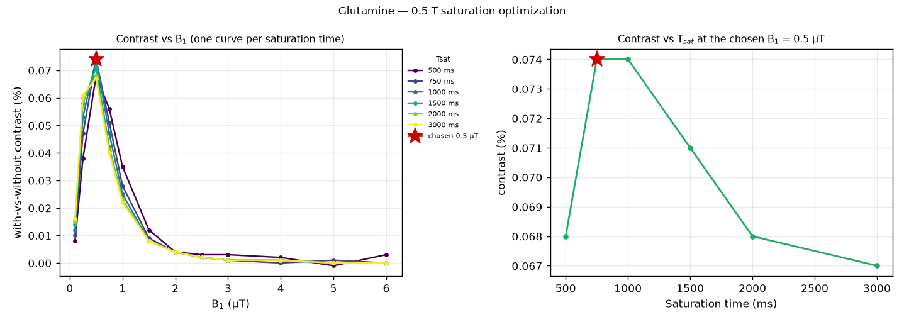

<b>1.5 T</b>  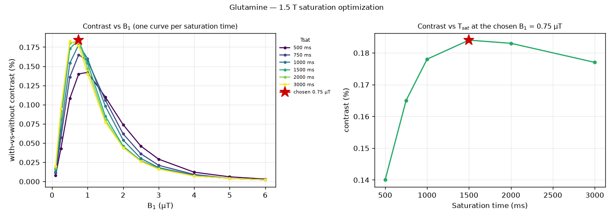

<b>3 T</b>  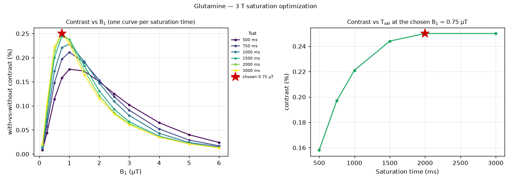

<b>5 T</b>  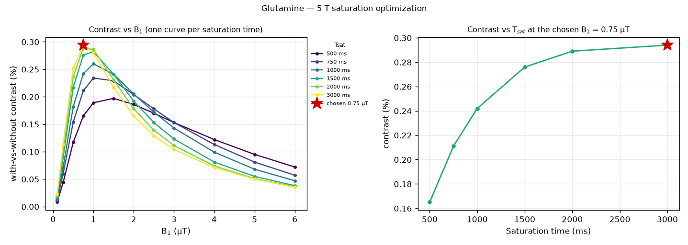

<b>7 T</b>  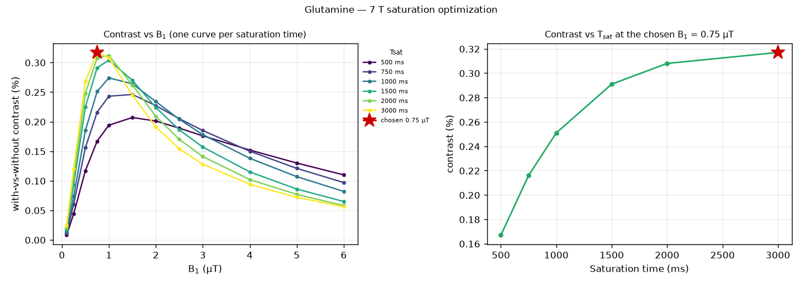

## Glycogen glucosyl units -- not detectable

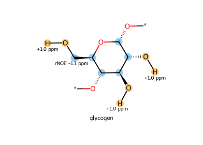
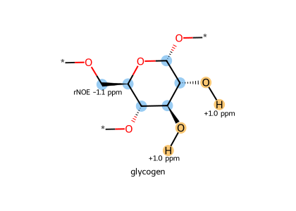
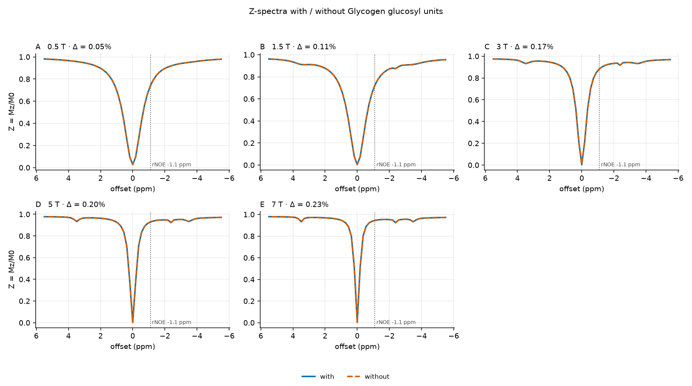

- **Concentration:** 7.80 mM typical (3.5–7.8 mM glucosyl units)
  - Source excerpt (PMID 26202425): "glycogen content in the healthy human brain tissue was found to be 7.8 +/- 0.3 µmol/g"
  - Reference database (biofluid, for comparison): TISSUE — no curated brain concentration found in BioNumbers for this metabolite; the tissue number in this report is therefore not reference-grounded | BIOFLUID (HMDB HMDB0000757, Glycogen, 2 cited records) — Blood 39.1 +/-  3.1 uM (Geigy Scientific Tables, 8th Rev edition, pp. 165-177. Edite); Blood 43.3 +/- 3.4 uM (Geigy Scientific Tables, 8th Rev edition, pp. 165-177. Edite)
- **CEST-detectable (simulated):** not detectable
- **Exchangeable protons:** Hydroxyl (C2-OH, C3-OH, C4-OH) (3H, +0.80 ppm, fast exchange, exchangeable); C6-OH (CH2OH) (1H, +0.60 ppm, fast exchange, exchangeable); Aliphatic C-H (rNOE, glycoNOE) (7H, -1.00 ppm, rNOE (dipolar, relayed) exchange, not exchangeable)
- **Simulation inputs** (k_ex and shift from the cited reference table for each group's class -- the model chose only the class; concentration from the literature agent):
  - Hydroxyl (C2-OH, C3-OH, C4-OH) [hydroxyl], 3H at 7.8 mM: k_ex 31850 s⁻¹, offset 1 ppm (chemist estimate +0.8 ppm, not used) **[borrowed from another tissue/setting]**. Max contrast: 0.5 T: 0.04%, 1.5 T: 0.04%, 3 T: 0.04%, 5 T: 0.04%, 7 T: 0.05%
    - k_ex 31850 s⁻¹ from 31850 s⁻¹ ([PMID 38933551] glycogen hydroxyl protons, phantom/solution, phantom, mouse, in vitro glycogen solution, 37 °C; pH not stated for this value (abstract says R2 depends on concentration, pH and field strength); field strength not stated in abstract; derived from transverse relaxation via Swift-Connick theory, not from CEST.
    - In vivo part: mouse liver T₂-weighted imaging after glucagon) shift 1 ppm, the median of 2 values from every tissue and setting: 1 ppm ([PMID 19358232] glycogen hydroxyl protons, human in vivo, muscle, human, 3 T sample (phantom vs human muscle) not stated in abstract MeSH terms include Humans and Muscle, Skeletal pH/temperature not stated)
    - 1 ppm ([PMID 36161668] glycogen hydroxyl protons, human in vivo, liver, human, human liver in vivo, 3 T, free-breathing 3D steady-state CEST (MR multitasking), 53 offsets post-fasting vs post-meal) a single k_ex measurement with no stated range, so its uncertainty is unknown and no k_ex spread enters the uncertainty corners no brain-specific exchange-rate measurement in the reference table
    - borrowed from phantom, mouse, phantom/solution. pool T₁ 1.0 s / T₂ 10 ms are generic small-solute values, not measured for this metabolite.
  - C6-OH (CH2OH) [hydroxyl], 1H at 7.8 mM: k_ex 31850 s⁻¹, offset 1 ppm (chemist estimate +0.6 ppm, not used) **[borrowed from another tissue/setting]**. Max contrast: 0.5 T: 0.01%, 1.5 T: 0.01%, 3 T: 0.01%, 5 T: 0.01%, 7 T: 0.02%
    - k_ex 31850 s⁻¹ from 31850 s⁻¹ ([PMID 38933551] glycogen hydroxyl protons, phantom/solution, phantom, mouse, in vitro glycogen solution, 37 °C; pH not stated for this value (abstract says R2 depends on concentration, pH and field strength); field strength not stated in abstract; derived from transverse relaxation via Swift-Connick theory, not from CEST.
    - In vivo part: mouse liver T₂-weighted imaging after glucagon) shift 1 ppm, the median of 2 values from every tissue and setting: 1 ppm ([PMID 19358232] glycogen hydroxyl protons, human in vivo, muscle, human, 3 T sample (phantom vs human muscle) not stated in abstract MeSH terms include Humans and Muscle, Skeletal pH/temperature not stated)
    - 1 ppm ([PMID 36161668] glycogen hydroxyl protons, human in vivo, liver, human, human liver in vivo, 3 T, free-breathing 3D steady-state CEST (MR multitasking), 53 offsets post-fasting vs post-meal) a single k_ex measurement with no stated range, so its uncertainty is unknown and no k_ex spread enters the uncertainty corners no brain-specific exchange-rate measurement in the reference table
    - borrowed from phantom, mouse, phantom/solution. pool T₁ 1.0 s / T₂ 10 ms are generic small-solute values, not measured for this metabolite.
  - Aliphatic C-H (rNOE, glycoNOE) [rnoe, rNOE], 7H at 7.8 mM: transfer rate 5 s⁻¹, offset -1.1 ppm (chemist estimate -1.0 ppm, not used) **[borrowed from another tissue/setting]**. Max contrast: 0.5 T: 0.05%, 1.5 T: 0.11%, 3 T: 0.17%, 5 T: 0.20%, 7 T: 0.23%
    - effective rNOE transfer rate 5 s⁻¹ from 5 s⁻¹ ([PMID 25996515] generic rNOE protons, phantom/solution, phantom, protein solutions/phantoms (NMR and MRI demonstration); approximate value stated for NOE-mediated transfer as a class; field, pH, temperature not stated in abstract)
    - shift -1.1 ppm, the median of 2 values from every tissue and setting: -1 ppm ([PMID 39529314] glycogen rNOE protons, animal in vivo, muscle, mouse, mouse skeletal muscle in vivo (GSD II model and normal); multi-pool Lorentzian fitting; field/pH/temperature not stated in abstract)
    - -1.2 ppm ([PMID 42076810] glycogen rNOE protons, animal in vivo, muscle, mouse, acid alpha-glucosidase-deficient (Pompe) mouse skeletal muscle in vivo; QUASS multi-pool quantitative CEST; field not stated in abstract) a single k_ex measurement with no stated range, so its uncertainty is unknown and no k_ex spread enters the uncertainty corners
    - no measurement of Glycogen glucosyl units's own rnoe protons in the reference table a class-level rnoe value is used no brain-specific exchange-rate measurement in the reference table borrowed from phantom, phantom/solution. pool T₁ 1.0 s / T₂ 10 ms are generic small-solute values, not measured for this metabolite.
- **Simulated with-vs-without-metabolite contrast (panel letters as in the Z-spectrum figure):**
  - A — 0.5 T: 0.054% (at that offset water alone loses 25.16% to direct saturation, the MT pool (0.114 of water) and background pools 0.83%); 2 warning(s)
  - B — 1.5 T: 0.109% (at that offset water alone loses 25.50% to direct saturation, the MT pool (0.114 of water) and background pools 1.97%); 2 warning(s)
  - C — 3 T: 0.167% (at that offset water alone loses 8.93% to direct saturation, the MT pool (0.114 of water) and background pools 2.61%); 1 warning(s)
  - D — 5 T: 0.205% (at that offset water alone loses 4.07% to direct saturation, the MT pool (0.114 of water) and background pools 2.94%); 1 warning(s)
  - E — 7 T: 0.227% (at that offset water alone loses 2.37% to direct saturation, the MT pool (0.114 of water) and background pools 3.06%); 1 warning(s)
- **Robustness to input uncertainty: no:** Contrast over the uncertainty corners (Aliphatic C-H (rNOE, glycoNOE) [rnoe]: concentration 3.5-7.8 mM, k_ex fixed at 5 s⁻¹ (single measurement, spread unknown)) at the swept B₁/Tsat: 0.5 T: 0.02-0.05%, 1.5 T: 0.05-0.11%, 3 T: 0.07-0.17%, 5 T: 0.09-0.20%, 7 T: 0.10-0.23%. Threshold 0.5%.
- **Frequency-collision analysis:** Hydroxyl groups (1.0 ppm): completely merge with ascorbate (1.0 ppm, 0 Hz), myo-inositol (0.72 ppm, 5.9 Hz but linewidth ~5196 Hz), and glucose (1.6 ppm, 12.8 Hz but linewidth ~6032 Hz). rNOE group (-1.1 ppm): at 0.5–1.5 T, overlaps with myo-inositol (0.72 ppm, 38.9–116.6 Hz). At all fields, overlaps with semisolid MT (-2.40 ppm, 27.7–387.4 Hz). rNOE is better separated at higher fields.
- **Direct water saturation note:** Hydroxyl groups: fast exchange regime at 0.5–1.5 T, intermediate at 3–7 T. Direct saturation dominates at low fields. rNOE: slow exchange at all fields — upfield offset (-1.1 ppm) is well clear of water.
- **Ex vivo/in vivo exchange-rate caveat:** Hydroxyl k_ex (31850 s⁻¹) from PMID 38933551: in vitro glycogen solution (mouse liver phantom) measured by Swift-Connick T₂ theory, not CEST. No brain-specific measurement. rNOE effective rate (5 s⁻¹) is a class-level phantom value (PMID 25996515). No brain glycogen rNOE measurement exists.
- **Optimized saturation sequence by field strength** (simulation-optimized):
  - 0.5 T: B₁=0.1 µT, Tsat=3000 ms, continuous wave (CW-equivalent B1_rms from simulation sweep) — 
    - recommended sequence: 0.054% contrast; no SAR ceiling applied
  - 1.5 T: B₁=0.25 µT, Tsat=3000 ms, continuous wave (CW-equivalent B1_rms from simulation sweep) — 
    - recommended sequence: 0.109% contrast; no SAR ceiling applied
  - 3 T: B₁=0.25 µT, Tsat=3000 ms, continuous wave (CW-equivalent B1_rms from simulation sweep) — 
    - recommended sequence: 0.167% contrast; no SAR ceiling applied
  - 5 T: B₁=0.25 µT, Tsat=3000 ms, continuous wave (CW-equivalent B1_rms from simulation sweep) — 
    - recommended sequence: 0.205% contrast; no SAR ceiling applied
  - 7 T: B₁=0.25 µT, Tsat=3000 ms, continuous wave (CW-equivalent B1_rms from simulation sweep) — 
    - recommended sequence: 0.227% contrast; no SAR ceiling applied
- **B₁/Tsat vs. extraction method:** rNOE pools require very low B₁ (~0.25 µT) due to slow effective transfer rate (5 s⁻¹). At higher B₁, the rNOE signal is reduced by direct saturation of the water and T₂ blurring. Extraction typically uses multi-pool Lorentzian fitting (5-pool model) or MTRasym for the rNOE/amide asymmetry analysis.
- **Potential clinical impact** (hydroxyl (glycoCEST, ~0.5-1.5 ppm)): 0 CEST/NOE application and 1 metabolite-change studies verified (1 human, 0 animal; 0 humans, 0 animals; 1 dropped by verification). No brain glycogen CEST studies found. Biochemical evidence shows glycogen phosphorylase (PYGL/PYGB) is upregulated in glioblastoma and glycogenolysis is activated in cerebral ischemia. Brain glycogen represents an unexplored CEST target.

  | Evidence | Disease | Species / setting | n disease / control | Metric / method | Disease vs control | Result | PMID |
  |---|---|---|---|---|---|---|---|
  | metabolite change | glioblastoma (tumor) | human, human in vivo | ? / ? | PYGL/PYGB mRNA and protein expression (biochemical) | — | PYGL higher in GBM vs normal brain; Tissue analysis, not imaging | 35764612 |

  - Pooled group difference: not computed (fewer than 3 verified studies with group means, SDs and sizes for one evidence type and disease category).
  - Dropped by verification: PMID 33485068: quote text not found in the abstract
- **Key literature:**
  - PMID 26202425 (2015): Revisiting Glycogen Content in the Human Brain [human in vivo, human]
  - PMID 17132822 (2007): Human brain glycogen content and metabolism: implications on its role in brain energy metabolism [human in vivo, human, n=9]
- **Caveats / critique:**
  - 7.8 mM glucosyl units is on the higher end for brain glycogen (typical 3–8 mM). Astrocytes store glycogen, so this may represent local concentration in glial-rich regions. Acceptable as upper estimate. Correctly identifies three groups: C2-C4 hydroxyls (hydroxyl), C6-OH (hydroxyl), and aliphatic C-H for rNOE (rnoe). Hydroxyl classifications are correct. rNOE classification for non-exchangeable C-H is correct.
  - However, the 7 aliphatic C-H protons per glucosyl unit include the anomeric H at ~5.3 ppm (which is NOT upfield and would not contribute to the -1 ppm rNOE) — the effective rNOE pool is the ring CH and CH2 at 3–4 ppm, whose relayed NOE appears at -1 ppm. Minor overcount but the class is correct.
  - Glycogen rNOE at -1 ppm from PMID 39529314 (mouse skeletal muscle, not brain). In brain, no specific glycogen rNOE shift has been validated. Simulated at -1.1 ppm. None. All exchangeable hydroxyls accounted for.
  - The anomeric C1-OH is part of the glycosidic bond and not a free OH (the polymeric linkage consumes it) — so 3 hydroxyls per glucosyl unit is correct (not 4). Agent 2's C2,C3,C4 plus C6 = 4 is a slight overcount; C1 is the glycosidic oxygen.
  - no SAR or hardware ceiling is applied: the recommended B₁/Tsat is the sweep optimum, and deliverability must be checked against the scanner's SAR monitor Concentration is reported as glucosyl unit mM (mM of glucose monomers per tissue volume), not as intact glycogen molecule molarity (which would be pM).
  - This is the correct exchangeable-proton-equivalent framework: each glucosyl unit has 3 exchangeable hydroxyl (-OH) groups. n_exchangeable_protons = 3 per glucosyl unit. The earlier estimate of 3.5 µmol/g (PMID 17132822) was revised upward to 7.8 µmol/g (PMID 26202425).
  - For comparison, fed human liver glycogen is ~200-400 mM glucosyl units, muscle ~80-100 mM glucosyl units; brain is much lower. glycoCEST targets the -OH protons at ~0.5-1.5 ppm from water.
  - [Eligibility] typical_concentration_mM (7.8 mM) looks like the intact macromolecule's own molarity rather than its exchangeable-proton pool concentration -- this survived the re-emission check meant to catch it, so the simulated contrast for this metabolite is likely a severe underestimate.

Saturation scheme and B1/Tsat optimization landscape at each field (10 figures)

<b>0.5 T</b>  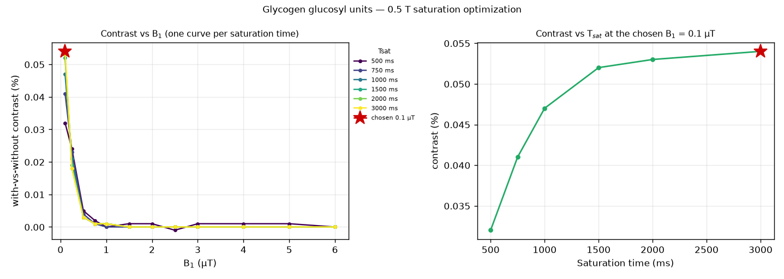

<b>1.5 T</b>  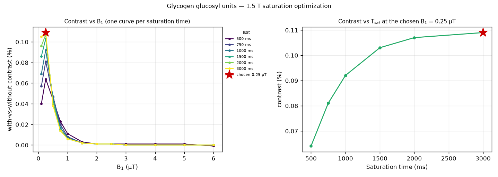

<b>3 T</b>  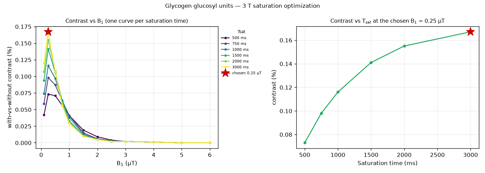

<b>5 T</b>  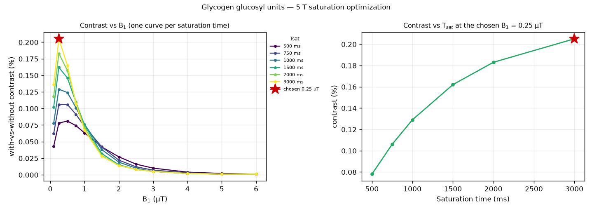

<b>7 T</b>  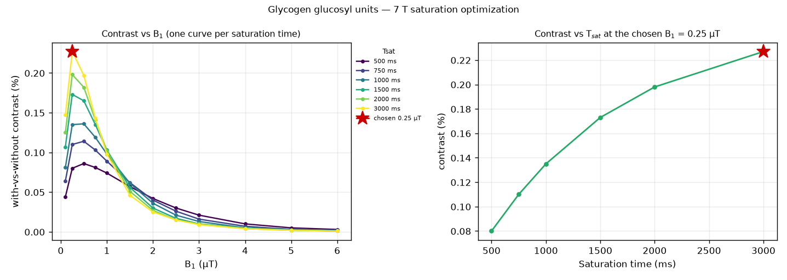

## N-Acetylaspartylglutamate -- not detectable

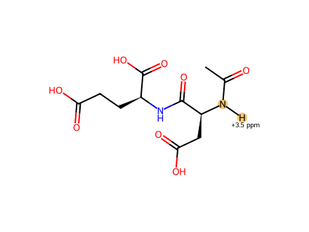
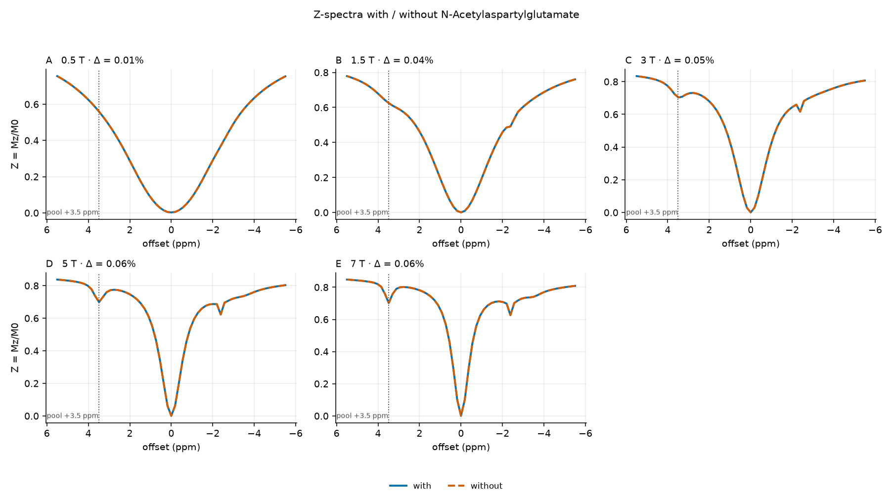

- **Concentration:** 1.50 mM typical (0.6–2.7 mM)
  - Source excerpt (PMID 9267864): "NAAG concentrations of 1.5-2.7 mM were higher in white matter than levels of 0.6-1.5 mM found in gray matter"
  - Reference database (biofluid, for comparison): TISSUE — no curated brain concentration found in BioNumbers for this metabolite; the tissue number in this report is therefore not reference-grounded | BIOFLUID (HMDB HMDB0001067, N-Acetylaspartylglutamic acid, 6 cited records) — Blood 4.89 +/- 0.12 uM (PMID 16139832)
- **Structure check:** Chemist agent's proposed structure was WRONG and has been replaced with PubChem's verified structure for 'N-Acetylaspartylglutamate'. Rejected SMILES: 'CC(=O)N[C@@H](CC(=O)N[C@@H](CCC(=O)O)C(=O)O)C(=O)O'; PubChem: 'CC(=O)N[C@@H](CC(=O)O)C(=O)N[C@@H](CCC(=O)O)C(=O)O'. The exchangeable-proton groups below are still the chemist's own analysis and may have been reasoned from the wrong structure.
- **CEST-detectable (simulated):** not detectable
- **Exchangeable protons:** Amide NH (N-acetyl) (1H, +3.50 ppm, slow exchange, exchangeable); Peptide backbone NH (Asp-Glu) (1H, +3.90 ppm, slow exchange, exchangeable)
- **Simulation inputs** (k_ex and shift from the cited reference table for each group's class -- the model chose only the class; concentration from the literature agent):
  - Amide NH (N-acetyl) [amide], 1H at 1.5 mM: k_ex 116 s⁻¹, offset 3.5 ppm. Max contrast: 0.5 T: 0.01%, 1.5 T: 0.04%, 3 T: 0.05%, 5 T: 0.06%, 7 T: 0.06%
    - k_ex 116 s⁻¹ from 116 s⁻¹ ([PMID 40228056] generic amide protons, human in vivo, brain, human, healthy human brain, in vivo; field strength, pH and temperature not stated in abstract)
    - shift 3.5 ppm, the median of 16 values from every tissue and setting: 3 ppm ([PMID 23400954] generic amide protons, human in vivo, brain, human, human brain, in vivo; field strength, pH, temperature not stated in abstract)
    - 3.5 ppm ([PMID 26845067] generic amide protons, human in vivo, brain, human, human brain, glioblastoma patients (n = 11), in vivo, 7 T; also protein model solutions and tissue lysates; pH/temperature not stated) 3.5 ppm ([PMID 25727379] generic amide protons, human in vivo, brain, human, human brain, 10 glioblastoma patients, in vivo, 7 T; pH/temperature not stated)
    - 3.5 ppm ([PMID 26334509] generic amide protons, human in vivo, liver, human, LIVER: rat liver in vivo (fasting; CCl4 intoxication) and human liver in vivo, 3.0 T; TSE with continuous rectangular saturation pulse, 41 offsets -5 to 5 ppm; pH/temperature not stated)
    - 3.5 ppm ([PMID 26391991] generic amide protons, human in vivo, liver, human, LIVER: 15 healthy human volunteers, in vivo, 3.0 T; after-meal vs 12-h fast; pH/temperature not stated) 3.5 ppm ([PMID 36161668] generic amide protons, human in vivo, liver, human, LIVER: human, in vivo, 3.0 T, steady-state CEST with MR multitasking, 53 offsets; post-fasting vs post-meal; pH/temperature not stated)
    - 3.5 ppm ([PMID 32785767] generic amide protons, human in vivo, liver, LIVER: 203 patients, in vivo, 3 T, single-slice TSE, breath-hold; pH/temperature not stated) 3.5 ppm ([PMID 38703021] generic amide protons, human in vivo, abdomen, human, human abdomen (abdominal organs), 12 subjects, in vivo, 3 T; iopamidol/iohexol pH phantoms; pH/temperature not stated for tissue)
    - 3.5 ppm ([PMID 24474497] generic amide protons, animal in vivo, brain, rat, rat brain tumors, in vivo, 9.4 T; pH/temperature not stated) 3.5 ppm ([PMID 24496171] generic amide protons, animal in vivo, brain, mouse, mouse brain, focal permanent MCAO, in vivo; in vivo pH calibration via 31P-MRS; in vitro phantoms; field strength not stated in abstract)
    - 3.6 ppm ([PMID 28602944] generic amide protons, animal in vivo, brain, rat, rat brain, in vivo (hypercapnia gas challenge and experimental stroke); protamine phantoms; field strength, pH, temperature not stated)
    - 3.6 ppm ([PMID 30553917] generic amide protons, animal in vivo, brain, mouse, mouse brain (AD model vs wild-type), in vivo; egg white, glutamate and cross-linked BSA phantoms; field strength, pH, temperature not stated) 3.5 ppm ([PMID 37317709] generic amide protons, animal in vivo, brain, animal (rodent) brain, in vivo, 9.4 T; saturation power 0.25-1 μT; pH/temperature not stated)
    - 3.6 ppm ([PMID 25542802] generic amide protons, phantom/solution, phantom, mouse, in vitro hydrogel components (HA, GelinS, PEGDA), then implanted in rag2-/- mouse brain in vivo; field strength, pH, temperature not stated) 3.5 ppm ([PMID 29193448] generic amide protons, computational/review, simulations (Rex metric); no tissue/field/pH stated) 3.5 ppm ([PMID 31728316] generic amide protons, computational/review, review; not stated in abstract)
    - k_ex spread across this tier (values and their stated ranges) 76-158 s⁻¹, used for the uncertainty corners no measurement of N-Acetylaspartylglutamate's own amide protons in the reference table a class-level amide value is used. pool T₁ 1.0 s / T₂ 10 ms are generic small-solute values, not measured for this metabolite.
  - Peptide backbone NH (Asp-Glu) [amide], 1H at 1.5 mM: k_ex 116 s⁻¹, offset 3.5 ppm (chemist estimate +3.9 ppm, not used). Max contrast: 0.5 T: 0.01%, 1.5 T: 0.04%, 3 T: 0.05%, 5 T: 0.06%, 7 T: 0.06%
    - k_ex 116 s⁻¹ from 116 s⁻¹ ([PMID 40228056] generic amide protons, human in vivo, brain, human, healthy human brain, in vivo; field strength, pH and temperature not stated in abstract)
    - shift 3.5 ppm, the median of 16 values from every tissue and setting: 3 ppm ([PMID 23400954] generic amide protons, human in vivo, brain, human, human brain, in vivo; field strength, pH, temperature not stated in abstract)
    - 3.5 ppm ([PMID 26845067] generic amide protons, human in vivo, brain, human, human brain, glioblastoma patients (n = 11), in vivo, 7 T; also protein model solutions and tissue lysates; pH/temperature not stated) 3.5 ppm ([PMID 25727379] generic amide protons, human in vivo, brain, human, human brain, 10 glioblastoma patients, in vivo, 7 T; pH/temperature not stated)
    - 3.5 ppm ([PMID 26334509] generic amide protons, human in vivo, liver, human, LIVER: rat liver in vivo (fasting; CCl4 intoxication) and human liver in vivo, 3.0 T; TSE with continuous rectangular saturation pulse, 41 offsets -5 to 5 ppm; pH/temperature not stated)
    - 3.5 ppm ([PMID 26391991] generic amide protons, human in vivo, liver, human, LIVER: 15 healthy human volunteers, in vivo, 3.0 T; after-meal vs 12-h fast; pH/temperature not stated) 3.5 ppm ([PMID 36161668] generic amide protons, human in vivo, liver, human, LIVER: human, in vivo, 3.0 T, steady-state CEST with MR multitasking, 53 offsets; post-fasting vs post-meal; pH/temperature not stated)
    - 3.5 ppm ([PMID 32785767] generic amide protons, human in vivo, liver, LIVER: 203 patients, in vivo, 3 T, single-slice TSE, breath-hold; pH/temperature not stated) 3.5 ppm ([PMID 38703021] generic amide protons, human in vivo, abdomen, human, human abdomen (abdominal organs), 12 subjects, in vivo, 3 T; iopamidol/iohexol pH phantoms; pH/temperature not stated for tissue)
    - 3.5 ppm ([PMID 24474497] generic amide protons, animal in vivo, brain, rat, rat brain tumors, in vivo, 9.4 T; pH/temperature not stated) 3.5 ppm ([PMID 24496171] generic amide protons, animal in vivo, brain, mouse, mouse brain, focal permanent MCAO, in vivo; in vivo pH calibration via 31P-MRS; in vitro phantoms; field strength not stated in abstract)
    - 3.6 ppm ([PMID 28602944] generic amide protons, animal in vivo, brain, rat, rat brain, in vivo (hypercapnia gas challenge and experimental stroke); protamine phantoms; field strength, pH, temperature not stated)
    - 3.6 ppm ([PMID 30553917] generic amide protons, animal in vivo, brain, mouse, mouse brain (AD model vs wild-type), in vivo; egg white, glutamate and cross-linked BSA phantoms; field strength, pH, temperature not stated) 3.5 ppm ([PMID 37317709] generic amide protons, animal in vivo, brain, animal (rodent) brain, in vivo, 9.4 T; saturation power 0.25-1 μT; pH/temperature not stated)
    - 3.6 ppm ([PMID 25542802] generic amide protons, phantom/solution, phantom, mouse, in vitro hydrogel components (HA, GelinS, PEGDA), then implanted in rag2-/- mouse brain in vivo; field strength, pH, temperature not stated) 3.5 ppm ([PMID 29193448] generic amide protons, computational/review, simulations (Rex metric); no tissue/field/pH stated) 3.5 ppm ([PMID 31728316] generic amide protons, computational/review, review; not stated in abstract)
    - k_ex spread across this tier (values and their stated ranges) 76-158 s⁻¹, used for the uncertainty corners no measurement of N-Acetylaspartylglutamate's own amide protons in the reference table a class-level amide value is used. pool T₁ 1.0 s / T₂ 10 ms are generic small-solute values, not measured for this metabolite.
- **Simulated with-vs-without-metabolite contrast (panel letters as in the Z-spectrum figure):**
  - A — 0.5 T: 0.014% (at that offset water alone loses 38.07% to direct saturation, the MT pool (0.114 of water) and background pools 5.77%); 5 warning(s)
  - B — 1.5 T: 0.035% (at that offset water alone loses 20.39% to direct saturation, the MT pool (0.114 of water) and background pools 16.95%); 5 warning(s)
  - C — 3 T: 0.047% (at that offset water alone loses 7.28% to direct saturation, the MT pool (0.114 of water) and background pools 22.19%); 5 warning(s)
  - D — 5 T: 0.055% (at that offset water alone loses 3.63% to direct saturation, the MT pool (0.114 of water) and background pools 26.10%); 5 warning(s)
  - E — 7 T: 0.060% (at that offset water alone loses 2.12% to direct saturation, the MT pool (0.114 of water) and background pools 27.17%); 5 warning(s)
- **Robustness to input uncertainty: no:** Contrast over the uncertainty corners (Amide NH (N-acetyl) [amide]: concentration 0.6-2.7 mM, k_ex 76-158 s⁻¹) at the swept B₁/Tsat: 0.5 T: 0.01-0.03%, 1.5 T: 0.01-0.07%, 3 T: 0.01-0.09%, 5 T: 0.02-0.11%, 7 T: 0.02-0.12%. Threshold 0.5%.
- **Frequency-collision analysis:** Both simulated groups at 3.5 ppm — identical offset to NAA, mobile protein amide, glutamine carboxamide, and glutathione backbone amides. Zero Hz separation at all fields. Cannot be distinguished.
- **Direct water saturation note:** Same as other 3.5 ppm amides: at 0.5 T intermediate exchange with 21.3 Hz direct_sat bandwidth; at ≥1.5 T slow exchange, well-separated.
- **Ex vivo/in vivo exchange-rate caveat:** Both groups use class-level amide values (k_ex 116 s⁻¹, shift 3.5 ppm). No NAAG-specific measurement. The peptide backbone amide may have a different exchange rate from the N-acetyl amide but both are simulated identically.
- **Optimized saturation sequence by field strength** (simulation-optimized):
  - 0.5 T: B₁=0.5 µT, Tsat=750 ms, continuous wave (CW-equivalent B1_rms from simulation sweep) — 
    - recommended sequence: 0.014% contrast; no SAR ceiling applied
  - 1.5 T: B₁=0.75 µT, Tsat=1500 ms, continuous wave (CW-equivalent B1_rms from simulation sweep) — 
    - recommended sequence: 0.035% contrast; no SAR ceiling applied
  - 3 T: B₁=0.75 µT, Tsat=2000 ms, continuous wave (CW-equivalent B1_rms from simulation sweep) — 
    - recommended sequence: 0.047% contrast; no SAR ceiling applied
  - 5 T: B₁=0.75 µT, Tsat=3000 ms, continuous wave (CW-equivalent B1_rms from simulation sweep) — 
    - recommended sequence: 0.055% contrast; no SAR ceiling applied
  - 7 T: B₁=0.75 µT, Tsat=3000 ms, continuous wave (CW-equivalent B1_rms from simulation sweep) — 
    - recommended sequence: 0.060% contrast; no SAR ceiling applied
- **B₁/Tsat vs. extraction method:** N/A — contrast far below threshold. The swept B₁ (0.75 µT at ≥1.5 T) follows the amide optimum, but even with optimal settings the contrast is only 0.06% at 7 T.
- **Potential clinical impact** (NAAG (no dedicated CEST pool; MRS-only)): 0 CEST/NOE application and 3 metabolite-change studies verified (2 human, 1 animal; 41 humans, 0 animals; 0 dropped by verification). No NAAG CEST exists. Metabolite-change by 1H-MRS (often combined with NAA as tNAA) shows altered NAAG in schizophrenia (age-dependent) and cuprizone animal models. FOLH1 genetics link NAAG to cognition. No CEST potential identified.

  | Evidence | Disease | Species / setting | n disease / control | Metric / method | Disease vs control | Result | PMID |
  |---|---|---|---|---|---|---|---|
  | metabolite change | schizophrenia (psychiatric) | human, human in vivo | 21 / 20 | 1H-MRS NAAG | — | higher in younger patients, lower in older; Age-dependent effect | 23081992 |
  | metabolite change | psychosis / cognition (FOLH1 variant) (psychiatric) | human, human in vivo | ? / ? | 7T 1H-MRS NAAG | — | lower NAAG with risk allele | 33256444 |
  | metabolite change | cuprizone mouse model (schizophrenia) (psychiatric) | mouse, animal in vivo | ? / ? | 1H-MRS NAA+NAAG | — | decreased in caudoputamen | 25347963 |

  - Pooled group difference: not computed (fewer than 3 verified studies with group means, SDs and sizes for one evidence type and disease category).
- **Key literature:**
  - PMID 9267864 (1997): Differential distribution of NAA and NAAG in human brain as determined by quantitative localized proton MRS [human in vivo, human]
- **Caveats / critique:**
  - 1.5 mM is within literature range (0.6–2.7 mM) for NAAG in human brain. Acceptable. Correctly identifies two amide groups: N-acetyl amide and peptide backbone NH (both class amide, correct). The estimated shift of 3.9 ppm for the backbone NH is reasonable (deshielded relative to N-acetyl at ~3.5 ppm).
  - However, both groups were simulated at 3.5 ppm — the distinction between them is lost. No other exchangeable groups missed. No NAAG CEST literature found.
  - The peptide backbone NH chemical shift in mobile proteins is typically 7.5–8.5 ppm in solution NMR, not 3.5 or 3.9 ppm — the 3.5 ppm value is the CEST-referenced offset (the difference from water, not the absolute ¹H shift). This is a common notation in CEST: 3.5 ppm downfield from water. None.
  - NAAG has no free amines or hydroxyls; carboxylates are deprotonated. Two amides are the only exchangeable protons. no SAR or hardware ceiling is applied: the recommended B₁/Tsat is the sweep optimum, and deliverability must be checked against the scanner's SAR monitor Chemist agent's proposed structure was WRONG and has been replaced with PubChem's verified structure for 'N-Acetylaspartylglutamate'.
  - Rejected SMILES: 'CC(=O)N[C@@H](CC(=O)N[C@@H](CCC(=O)O)C(=O)O)C(=O)O'; PubChem: 'CC(=O)N[C@@H](CC(=O)O)C(=O)N[C@@H](CCC(=O)O)C(=O)O'. The exchangeable-proton groups below are still the chemist's own analysis and may have been reasoned from the wrong structure. NAAG has a peptide-bond amide proton that contributes to the APT signal at 3.5 ppm along with NAA. White matter has ~2-fold higher NAAG than gray matter.

Saturation scheme and B1/Tsat optimization landscape at each field (10 figures)

<b>0.5 T</b>  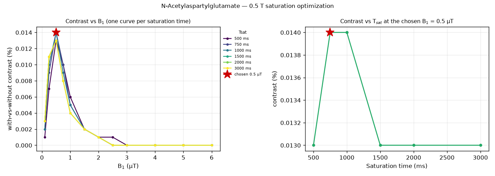

<b>1.5 T</b>  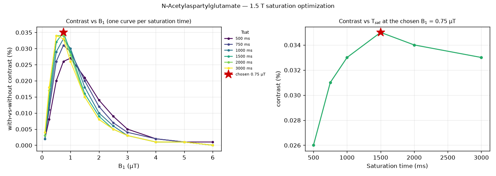

<b>3 T</b>  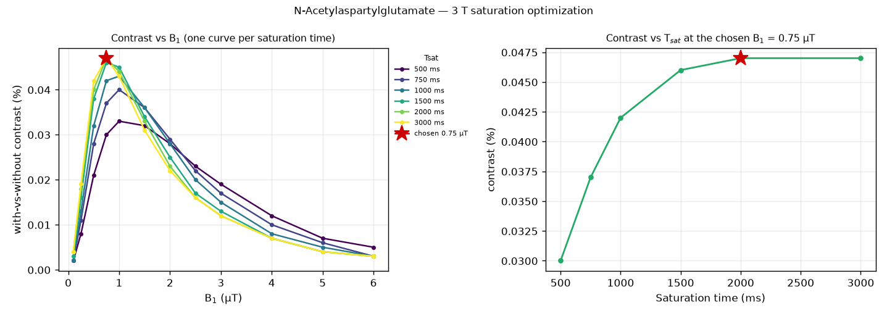

<b>5 T</b>  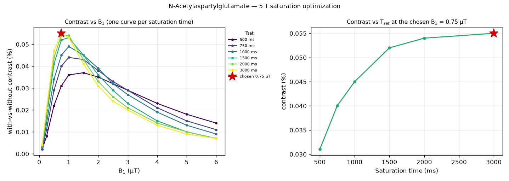

<b>7 T</b>  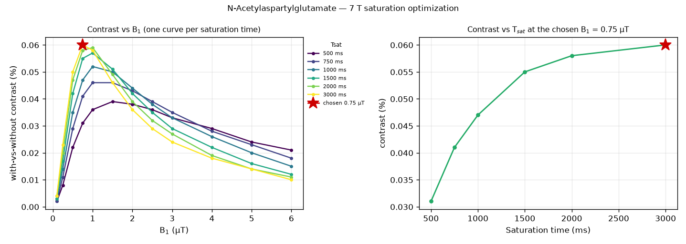

## Glutathione -- not detectable

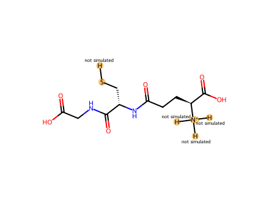
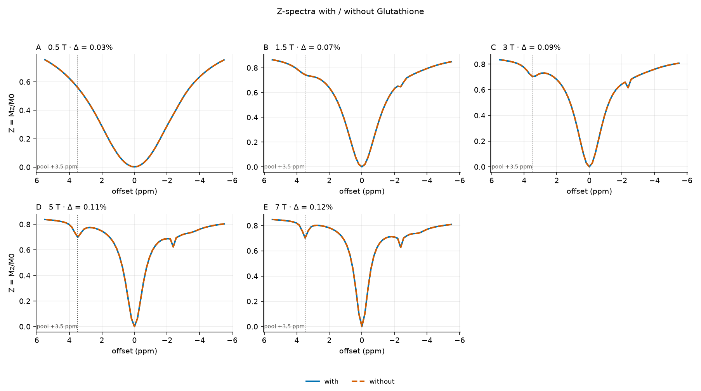

- **Concentration:** 1.50 mM typical (1–3 mM)
  - Source excerpt (PMID 28034792): "Healthy human brain glutathione concentration is ∼1-2 mM"
  - Reference database (biofluid, for comparison): TISSUE — no curated brain concentration found in BioNumbers for this metabolite; the tissue number in this report is therefore not reference-grounded | BIOFLUID (HMDB HMDB0000125, Glutathione, 17 cited records) — Blood 1.0738-1.725 uM (PMID 238530); Blood 12.8 +/- 4.6 uM (PMID 9554495); Blood 3.67 +/- 0.241 uM (PMID 25004141)
- **CEST-detectable (simulated):** not detectable
- **Exchangeable protons:** alpha-Amine NH3+ (Glu) (3H, +3.00 ppm, fast exchange, exchangeable); Peptide NH (Cys and Gly residues) (2H, +3.50 ppm, slow exchange, exchangeable); Thiol SH (Cys residue) (1H, +0.60 ppm, fast exchange, exchangeable)
- **Simulation inputs** (k_ex and shift from the cited reference table for each group's class -- the model chose only the class; concentration from the literature agent):
  - alpha-Amine NH3+ (Glu) [amine]: **NOT SIMULATED** (no_reference_for_group) -- the reference table has no verified exchange rate and shift for amine protons -- we don't know; not simulated
  - Peptide NH (Cys and Gly residues) [amide], 2H at 1.5 mM: k_ex 116 s⁻¹, offset 3.5 ppm. Max contrast: 0.5 T: 0.03%, 1.5 T: 0.07%, 3 T: 0.09%, 5 T: 0.11%, 7 T: 0.12%
    - k_ex 116 s⁻¹ from 116 s⁻¹ ([PMID 40228056] generic amide protons, human in vivo, brain, human, healthy human brain, in vivo; field strength, pH and temperature not stated in abstract)
    - shift 3.5 ppm, the median of 16 values from every tissue and setting: 3 ppm ([PMID 23400954] generic amide protons, human in vivo, brain, human, human brain, in vivo; field strength, pH, temperature not stated in abstract)
    - 3.5 ppm ([PMID 26845067] generic amide protons, human in vivo, brain, human, human brain, glioblastoma patients (n = 11), in vivo, 7 T; also protein model solutions and tissue lysates; pH/temperature not stated) 3.5 ppm ([PMID 25727379] generic amide protons, human in vivo, brain, human, human brain, 10 glioblastoma patients, in vivo, 7 T; pH/temperature not stated)
    - 3.5 ppm ([PMID 26334509] generic amide protons, human in vivo, liver, human, LIVER: rat liver in vivo (fasting; CCl4 intoxication) and human liver in vivo, 3.0 T; TSE with continuous rectangular saturation pulse, 41 offsets -5 to 5 ppm; pH/temperature not stated)
    - 3.5 ppm ([PMID 26391991] generic amide protons, human in vivo, liver, human, LIVER: 15 healthy human volunteers, in vivo, 3.0 T; after-meal vs 12-h fast; pH/temperature not stated) 3.5 ppm ([PMID 36161668] generic amide protons, human in vivo, liver, human, LIVER: human, in vivo, 3.0 T, steady-state CEST with MR multitasking, 53 offsets; post-fasting vs post-meal; pH/temperature not stated)
    - 3.5 ppm ([PMID 32785767] generic amide protons, human in vivo, liver, LIVER: 203 patients, in vivo, 3 T, single-slice TSE, breath-hold; pH/temperature not stated) 3.5 ppm ([PMID 38703021] generic amide protons, human in vivo, abdomen, human, human abdomen (abdominal organs), 12 subjects, in vivo, 3 T; iopamidol/iohexol pH phantoms; pH/temperature not stated for tissue)
    - 3.5 ppm ([PMID 24474497] generic amide protons, animal in vivo, brain, rat, rat brain tumors, in vivo, 9.4 T; pH/temperature not stated) 3.5 ppm ([PMID 24496171] generic amide protons, animal in vivo, brain, mouse, mouse brain, focal permanent MCAO, in vivo; in vivo pH calibration via 31P-MRS; in vitro phantoms; field strength not stated in abstract)
    - 3.6 ppm ([PMID 28602944] generic amide protons, animal in vivo, brain, rat, rat brain, in vivo (hypercapnia gas challenge and experimental stroke); protamine phantoms; field strength, pH, temperature not stated)
    - 3.6 ppm ([PMID 30553917] generic amide protons, animal in vivo, brain, mouse, mouse brain (AD model vs wild-type), in vivo; egg white, glutamate and cross-linked BSA phantoms; field strength, pH, temperature not stated) 3.5 ppm ([PMID 37317709] generic amide protons, animal in vivo, brain, animal (rodent) brain, in vivo, 9.4 T; saturation power 0.25-1 μT; pH/temperature not stated)
    - 3.6 ppm ([PMID 25542802] generic amide protons, phantom/solution, phantom, mouse, in vitro hydrogel components (HA, GelinS, PEGDA), then implanted in rag2-/- mouse brain in vivo; field strength, pH, temperature not stated) 3.5 ppm ([PMID 29193448] generic amide protons, computational/review, simulations (Rex metric); no tissue/field/pH stated) 3.5 ppm ([PMID 31728316] generic amide protons, computational/review, review; not stated in abstract)
    - k_ex spread across this tier (values and their stated ranges) 76-158 s⁻¹, used for the uncertainty corners no measurement of Glutathione's own amide protons in the reference table a class-level amide value is used. pool T₁ 1.0 s / T₂ 10 ms are generic small-solute values, not measured for this metabolite.
  - Thiol SH (Cys residue) [thiol]: **NOT SIMULATED** (no_reference_for_group) -- the reference table has no verified exchange rate and shift for thiol protons -- we don't know; not simulated
- **Simulated with-vs-without-metabolite contrast (panel letters as in the Z-spectrum figure):**
  - A — 0.5 T: 0.028% (at that offset water alone loses 38.07% to direct saturation, the MT pool (0.114 of water) and background pools 5.77%); 5 warning(s)
  - B — 1.5 T: 0.069% (at that offset water alone loses 11.78% to direct saturation, the MT pool (0.114 of water) and background pools 13.74%); 5 warning(s)
  - C — 3 T: 0.094% (at that offset water alone loses 7.28% to direct saturation, the MT pool (0.114 of water) and background pools 22.19%); 5 warning(s)
  - D — 5 T: 0.110% (at that offset water alone loses 3.63% to direct saturation, the MT pool (0.114 of water) and background pools 26.10%); 5 warning(s)
  - E — 7 T: 0.119% (at that offset water alone loses 2.12% to direct saturation, the MT pool (0.114 of water) and background pools 27.17%); 5 warning(s)
- **Robustness to input uncertainty: no:** Contrast over the uncertainty corners (Peptide NH (Cys and Gly residues) [amide]: concentration 1-3 mM, k_ex 76-158 s⁻¹) at the swept B₁/Tsat: 0.5 T: 0.02-0.06%, 1.5 T: 0.04-0.14%, 3 T: 0.05-0.21%, 5 T: 0.06-0.24%, 7 T: 0.06-0.26%. Threshold 0.5%.
- **Frequency-collision analysis:** Amide groups (simulated at 3.5 ppm): identical to NAA, mobile proteins, glutamine, NAAG. The unsimulated amine (3.0 ppm) would overlap with glutamate's amine. The unsimulated thiol (~0.6 ppm) would overlap with myo-inositol, glycogen, and ascorbate hydroxyls — the most unique of GSH's pools, but cannot be evaluated.
- **Direct water saturation note:** Simulated amide at 0.5 T: intermediate exchange, direct_sat_bandwidth 21.3 Hz. At ≥1.5 T: slow exchange, well-separated.
- **Ex vivo/in vivo exchange-rate caveat:** Only the amide group (2H) simulated using class-level amide values (116 s⁻¹). The amine (3H) and thiol (1H) are NOT SIMULATED — UNKNOWN. These two groups represent 4 of 6 exchangeable protons and likely carry most of GSH's CEST signal. Their omission is a significant gap.
- **Optimized saturation sequence by field strength** (simulation-optimized):
  - 0.5 T: B₁=0.5 µT, Tsat=750 ms, continuous wave (CW-equivalent B1_rms from simulation sweep) — 
    - recommended sequence: 0.028% contrast; no SAR ceiling applied
  - 1.5 T: B₁=0.5 µT, Tsat=3000 ms, continuous wave (CW-equivalent B1_rms from simulation sweep) — 
    - recommended sequence: 0.069% contrast; no SAR ceiling applied
  - 3 T: B₁=0.75 µT, Tsat=2000 ms, continuous wave (CW-equivalent B1_rms from simulation sweep) — 
    - recommended sequence: 0.094% contrast; no SAR ceiling applied
  - 5 T: B₁=0.75 µT, Tsat=3000 ms, continuous wave (CW-equivalent B1_rms from simulation sweep) — 
    - recommended sequence: 0.110% contrast; no SAR ceiling applied
  - 7 T: B₁=0.75 µT, Tsat=3000 ms, continuous wave (CW-equivalent B1_rms from simulation sweep) — 
    - recommended sequence: 0.119% contrast; no SAR ceiling applied
- **B₁/Tsat vs. extraction method:** N/A — contrast below threshold. If the thiol group were parameterized, low B₁ (~0.5 µT) would be needed due to fast thiol exchange, and Lorentzian fitting or AREX would be required to separate it from proximal hydroxyl pools.
- **Potential clinical impact** (GSH (no CEST pool; edited-MRS only)): 0 CEST/NOE application and 1 metabolite-change studies verified (1 human, 0 animal; 6 humans, 0 animals; 2 dropped by verification). No brain GSH CEST exists. GSH is measured by edited MRS (MEGA-PRESS/sLASER). Evidence shows lower brain GSH in AD and MCI (meta-analysis, MEGA-PRESS), decreased GSH in Parkinson disease, and elevated cystathionine with variable GSH in glioblastoma. Not a CEST target.

  | Evidence | Disease | Species / setting | n disease / control | Metric / method | Disease vs control | Result | PMID |
  |---|---|---|---|---|---|---|---|
  | metabolite change | Parkinson disease (neurodegeneration) | human, human in vivo | 3 / 3 | 7T 1H-MRS GSH | — | GSH detected; increased after NAC infusion; Small pilot study | 23860343 |

  - Pooled group difference: not computed (fewer than 3 verified studies with group means, SDs and sizes for one evidence type and disease category).
  - Dropped by verification: PMID 35123548: not a primary study (review, meta-analysis or editorial); PMID 42001191: quote text not found in the abstract
- **Key literature:**
  - PMID 28034792 (2017): Glutathione in the human brain: Review of its roles and measurement by magnetic resonance spectroscopy [human in vivo, human]
  - PMID 21834011 (2011): Noninvasive quantification of ascorbate and glutathione concentration in the elderly human brain [human in vivo, human]
- **Caveats / critique:**
  - 1.5 mM is within literature range (1–3 mM) for GSH in human brain. Acceptable. Thorough and accurate structural analysis. Correctly identifies three groups: (1) alpha-amine NH3+ (amine class, correct), (2) two backbone amides (amide class, correct), (3) Cys thiol SH (thiol class, correct). This is the most complete exchangeable-proton inventory among all metabolites.
  - The thiol group is unique among brain metabolites and could be specific. No GSH CEST literature found. The thiol SH would be expected at ~0.6 ppm (downfield from water) based on solution NMR — consistent with chemist's estimate. Not simulated. None. All three exchangeable groups are identified.
  - Groups not simulated: alpha-Amine NH3+ (Glu) [amine] -- the reference table has no verified exchange rate and shift for amine protons -- we don't know; not simulated; Thiol SH (Cys residue) [thiol] -- the reference table has no verified exchange rate and shift for thiol protons -- we don't know; not simulated
  - no SAR or hardware ceiling is applied: the recommended B₁/Tsat is the sweep optimum, and deliverability must be checked against the scanner's SAR monitor GSH has amine (-NH2), amide (-NH), and thiol (-SH) exchangeable protons. The thiol exchange is slow; amine/amide exchange contributes to CEST.

Saturation scheme and B1/Tsat optimization landscape at each field (10 figures)

<b>0.5 T</b> 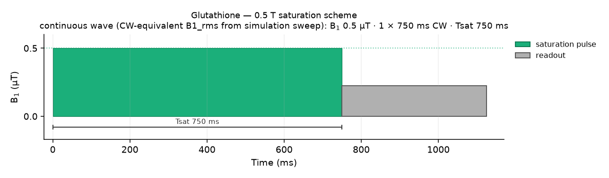 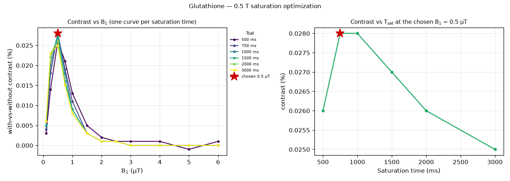

<b>1.5 T</b>  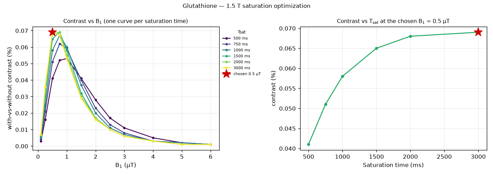

<b>3 T</b>  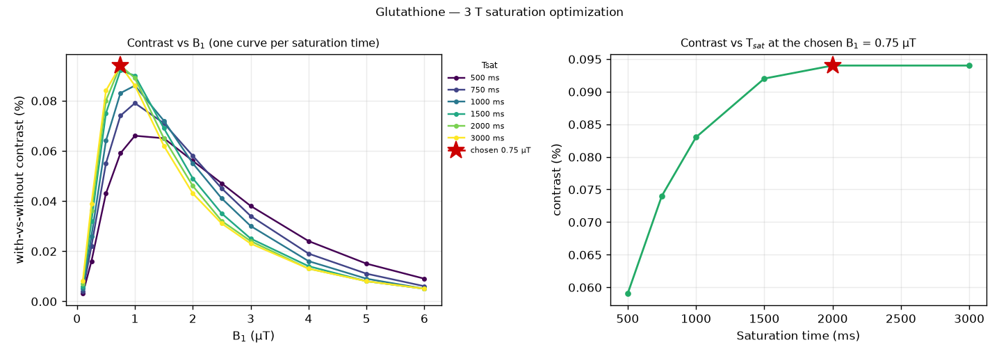

<b>5 T</b>  

<b>7 T</b>  

## Ascorbate -- not detectable

- **Concentration:** 1.30 mM typical (1.0–1.6 mM)
  - Source excerpt (PMID 14755644): "A concentration of 1.3 +/- 0.3 micromol/g (mean +/- SD, N = 4) was estimated"
  - Reference database (biofluid, for comparison): TISSUE — no curated brain concentration found in BioNumbers for this metabolite; the tissue number in this report is therefore not reference-grounded | BIOFLUID (HMDB HMDB0000044, Ascorbic acid, 29 cited records) — Blood 22.2 (14.0-40.0) uM (PMID 16522902); Blood 36.0 +/- 18.0 uM (PMID 15640471); Blood 48.829 +/- 23.847 uM (PMID 16755268)
- **CEST-detectable (simulated):** not detectable
- **Exchangeable protons:** Enediol OH (C2 and C3) (2H, +1.20 ppm, fast exchange, exchangeable); C5-OH and C6-OH (side chain) (2H, +0.60 ppm, fast exchange, exchangeable)
- **Simulation inputs** (k_ex and shift from the cited reference table for each group's class -- the model chose only the class; concentration from the literature agent):
  - Enediol OH (C2 and C3) [hydroxyl], 2H at 1.3 mM: k_ex 600 s⁻¹, offset 1 ppm (chemist estimate +1.2 ppm, not used). Max contrast: 0.5 T: 0.01%, 1.5 T: 0.01%, 3 T: 0.03%, 5 T: 0.06%, 7 T: 0.09%
    - k_ex 600 s⁻¹ from 600 s⁻¹ ([PMID 20951217] myo-inositol hydroxyl protons, human in vivo, brain, human, human brain in vivo, 7 T, N=5 healthy volunteers (WM 5.2+/-0.5 %, GM 4.3+/-0.5 % MICEST); pH/temperature for the k=600 s⁻¹ value not stated in abstract; the abstract does not say whether k was measured in phantom or in vivo)
    - shift 1 ppm, the median of 10 values from every tissue and setting: 0.8 ppm ([PMID 27071650] generic hydroxyl protons, phantom/solution, phantom, hyaluronic acid viscosupplement formulations (Synvisc, Orthovisc) in vitro; 7 T Siemens whole-body; B1rms 3.6 µT, 1 s saturation; pH/temperature not stated in abstract)
    - 1 ppm ([PMID 38703021] generic hydroxyl protons, human in vivo, abdomen, human, human abdomen in vivo (12 subjects), clinical 3 T; iopamidol/iohexol pH phantoms; CEST range +/-7 ppm) 1.5 ppm ([PMID 33103831] generic hydroxyl protons, animal in vivo, breast, mice bearing implanted 4T1 breast tumours in vivo after GlcN administration; field strength not stated in abstract; pH/temperature not stated)
    - 1 ppm ([PMID 31366892] generic hydroxyl protons, phantom/solution, phantom, rat, in vitro solutions, concentration- and pH-dependent; field strength/temperature not stated in abstract; in vivo: glioma-bearing rats) 1 ppm ([PMID 28558795] generic hydroxyl protons, animal in vivo, rat, rat 9L gliosarcoma in vivo, 9.4 T; in vitro contrast correlated positively with concentration and negatively with pH)
    - 0.8 ppm ([PMID 36432721] generic hydroxyl protons, phantom/solution, phantom, rat, in vitro, concentration and pH varied; field/temperature for in vitro not stated; in vivo: Sprague-Dawley rats, 11.7 T) 0.9 ppm ([PMID 34225021] generic hydroxyl protons, phantom/solution, phantom, mouse, phantoms (trehalose, cryptococcal cells) and murine cryptococcoma model in vivo; field strength/pH/temperature not stated in abstract)
    - 1.2 ppm ([PMID 35510307] generic hydroxyl protons, phantom/solution, phantom, 2D/3D HEK293T cell cultures, 9.4 T; pH cross-validated; temperature not stated) 1.8 ppm ([PMID 27816001] generic hydroxyl protons, phantom/solution, phantom, rat, in vitro ECM precursor/hydrogel; pH varied; 37 °C improved detection; field strength not stated in abstract; in vivo: rat stroke model)
    - 5.8 ppm ([PMID 1384851] generic hydroxyl protons, phantom/solution, phantom, aqueous solutions of model peptides and BPTI, 4 °C for random-coil values; pH varied for exchange-rate measurements (rates not given in abstract); field not stated) a single k_ex measurement with no stated range, so its uncertainty is unknown and no k_ex spread enters the uncertainty corners
    - no measurement of Ascorbate's own hydroxyl protons in the reference table borrowed from other metabolites' measurements (myo-inositol). pool T₁ 1.0 s / T₂ 10 ms are generic small-solute values, not measured for this metabolite.
  - C5-OH and C6-OH (side chain) [hydroxyl], 2H at 1.3 mM: k_ex 600 s⁻¹, offset 1 ppm (chemist estimate +0.6 ppm, not used). Max contrast: 0.5 T: 0.01%, 1.5 T: 0.01%, 3 T: 0.03%, 5 T: 0.06%, 7 T: 0.09%
    - k_ex 600 s⁻¹ from 600 s⁻¹ ([PMID 20951217] myo-inositol hydroxyl protons, human in vivo, brain, human, human brain in vivo, 7 T, N=5 healthy volunteers (WM 5.2+/-0.5 %, GM 4.3+/-0.5 % MICEST); pH/temperature for the k=600 s⁻¹ value not stated in abstract; the abstract does not say whether k was measured in phantom or in vivo)
    - shift 1 ppm, the median of 10 values from every tissue and setting: 0.8 ppm ([PMID 27071650] generic hydroxyl protons, phantom/solution, phantom, hyaluronic acid viscosupplement formulations (Synvisc, Orthovisc) in vitro; 7 T Siemens whole-body; B1rms 3.6 µT, 1 s saturation; pH/temperature not stated in abstract)
    - 1 ppm ([PMID 38703021] generic hydroxyl protons, human in vivo, abdomen, human, human abdomen in vivo (12 subjects), clinical 3 T; iopamidol/iohexol pH phantoms; CEST range +/-7 ppm) 1.5 ppm ([PMID 33103831] generic hydroxyl protons, animal in vivo, breast, mice bearing implanted 4T1 breast tumours in vivo after GlcN administration; field strength not stated in abstract; pH/temperature not stated)
    - 1 ppm ([PMID 31366892] generic hydroxyl protons, phantom/solution, phantom, rat, in vitro solutions, concentration- and pH-dependent; field strength/temperature not stated in abstract; in vivo: glioma-bearing rats) 1 ppm ([PMID 28558795] generic hydroxyl protons, animal in vivo, rat, rat 9L gliosarcoma in vivo, 9.4 T; in vitro contrast correlated positively with concentration and negatively with pH)
    - 0.8 ppm ([PMID 36432721] generic hydroxyl protons, phantom/solution, phantom, rat, in vitro, concentration and pH varied; field/temperature for in vitro not stated; in vivo: Sprague-Dawley rats, 11.7 T) 0.9 ppm ([PMID 34225021] generic hydroxyl protons, phantom/solution, phantom, mouse, phantoms (trehalose, cryptococcal cells) and murine cryptococcoma model in vivo; field strength/pH/temperature not stated in abstract)
    - 1.2 ppm ([PMID 35510307] generic hydroxyl protons, phantom/solution, phantom, 2D/3D HEK293T cell cultures, 9.4 T; pH cross-validated; temperature not stated) 1.8 ppm ([PMID 27816001] generic hydroxyl protons, phantom/solution, phantom, rat, in vitro ECM precursor/hydrogel; pH varied; 37 °C improved detection; field strength not stated in abstract; in vivo: rat stroke model)
    - 5.8 ppm ([PMID 1384851] generic hydroxyl protons, phantom/solution, phantom, aqueous solutions of model peptides and BPTI, 4 °C for random-coil values; pH varied for exchange-rate measurements (rates not given in abstract); field not stated) a single k_ex measurement with no stated range, so its uncertainty is unknown and no k_ex spread enters the uncertainty corners
    - no measurement of Ascorbate's own hydroxyl protons in the reference table borrowed from other metabolites' measurements (myo-inositol). pool T₁ 1.0 s / T₂ 10 ms are generic small-solute values, not measured for this metabolite.
- **Simulated with-vs-without-metabolite contrast (panel letters as in the Z-spectrum figure):**
  - A — 0.5 T: 0.005% (at that offset water alone loses 63.30% to direct saturation, the MT pool (0.114 of water) and background pools 1.22%); 7 warning(s)
  - B — 1.5 T: 0.012% (at that offset water alone loses 46.71% to direct saturation, the MT pool (0.114 of water) and background pools 2.44%); 3 warning(s)
  - C — 3 T: 0.030% (at that offset water alone loses 49.70% to direct saturation, the MT pool (0.114 of water) and background pools 5.60%); 3 warning(s)
  - D — 5 T: 0.058% (at that offset water alone loses 36.69% to direct saturation, the MT pool (0.114 of water) and background pools 10.02%); 3 warning(s)
  - E — 7 T: 0.087% (at that offset water alone loses 37.45% to direct saturation, the MT pool (0.114 of water) and background pools 13.78%); 3 warning(s)
- **Robustness to input uncertainty: no:** Contrast over the uncertainty corners (Enediol OH (C2 and C3) [hydroxyl]: concentration 1-1.6 mM, k_ex fixed at 600 s⁻¹ (single measurement, spread unknown)) at the swept B₁/Tsat: 0.5 T: 0.00-0.01%, 1.5 T: 0.01-0.01%, 3 T: 0.02-0.04%, 5 T: 0.04-0.07%, 7 T: 0.07-0.11%. Threshold 0.5%.
- **Frequency-collision analysis:** Simulated at 1.0 ppm: identical to glycogen hydroxyls (0 Hz separation, linewidth ~5196 Hz). At all fields, completely merged with glycogen, myo-inositol (0.72 ppm), and glucose (1.6 ppm) hydroxyls. Cannot be resolved as a separate pool.
- **Direct water saturation note:** At 0.5–1.5 T: 'fast exchange (merges toward water; poor CEST visibility, direct saturation dominates)'. At 3–7 T: 'intermediate exchange (partial separation; contrast reduced)'. Direct saturation is severe for this near-water pool.
- **Ex vivo/in vivo exchange-rate caveat:** k_ex (600 s⁻¹) borrowed from myo-inositol (PMID 20951217) — no ascorbate-specific measurement. Shift (1.0 ppm) is hydroxyl class median, not measured for ascorbate. Both groups in simulation use the same values — no distinction between enediol vs side-chain OH kinetics.
- **Optimized saturation sequence by field strength** (simulation-optimized):
  - 0.5 T: B₁=0.25 µT, Tsat=500 ms, continuous wave (CW-equivalent B1_rms from simulation sweep) — 
    - recommended sequence: 0.005% contrast; no SAR ceiling applied
  - 1.5 T: B₁=0.5 µT, Tsat=500 ms, continuous wave (CW-equivalent B1_rms from simulation sweep) — 
    - recommended sequence: 0.012% contrast; no SAR ceiling applied
  - 3 T: B₁=1 µT, Tsat=500 ms, continuous wave (CW-equivalent B1_rms from simulation sweep) — 
    - recommended sequence: 0.030% contrast; no SAR ceiling applied
  - 5 T: B₁=1 µT, Tsat=1000 ms, continuous wave (CW-equivalent B1_rms from simulation sweep) — 
    - recommended sequence: 0.058% contrast; no SAR ceiling applied
  - 7 T: B₁=1.5 µT, Tsat=750 ms, continuous wave (CW-equivalent B1_rms from simulation sweep) — 
    - recommended sequence: 0.087% contrast; no SAR ceiling applied
- **B₁/Tsat vs. extraction method:** N/A — contrast far below threshold. Would need multi-pool Lorentzian fitting to separate from other hydroxyls, which is practically impossible given complete spectral overlap.
- **Potential clinical impact** (hydroxyl/enol (no CEST pool)): 0 CEST/NOE application and 1 metabolite-change studies verified (0 human, 1 animal; 0 humans, 0 animals; 0 dropped by verification). No ascorbate CEST exists. Low brain concentration (1-3 mM) and fast exchange of enolic -OH protons make CEST unlikely. Biochemical evidence shows ascorbate is a major antioxidant with changes in hibernation/ischemia models and proposed roles in neurodegenerative diseases.

  | Evidence | Disease | Species / setting | n disease / control | Metric / method | Disease vs control | Result | PMID |
  |---|---|---|---|---|---|---|---|
  | metabolite change | hibernation (ischemia tolerance model) (stroke) | animal (ground squirrel), animal in vivo | ? / ? | plasma ascorbate concentration (biochemical) | — | increased 3-5 fold during hibernation; Relevance to cerebral ischemia tolerance | 12458177 |

  - Pooled group difference: not computed (fewer than 3 verified studies with group means, SDs and sizes for one evidence type and disease category).
- **Key literature:**
  - PMID 14755644 (2004): 1H NMR detection of vitamin C in human brain in vivo [human in vivo, human, n=5]
- **Caveats / critique:**
  - 1.3 mM is within literature range (1.0–1.6 mM) for ascorbate in human brain. Acceptable. Identifies two hydroxyl groups correctly (enediol OH and side-chain OH, both class hydroxyl). However, the C2-OH has pKa ~4.2 — at pH 7.4 it is ~99.9% deprotonated (monoanion form), carrying essentially no exchangeable proton.
  - The effective number of exchangeable OH protons is closer to 3 (C3-OH, C5-OH, C6-OH), not 4. This reduces effective concentration by ~25%. No ascorbate CEST literature found. The hydroxyl peaks would be in the 0.5–1.5 ppm range, overlapping other hydroxyl pools. Overcounted by 1 proton: C2-OH is deprotonated at pH 7.4 and does not contribute to CEST.
  - no SAR or hardware ceiling is applied: the recommended B₁/Tsat is the sweep optimum, and deliverability must be checked against the scanner's SAR monitor Ascorbate has 4 hydroxyl (-OH) groups on the lactone ring that can exchange. Concentration is just above the 1 mM threshold.

Saturation scheme and B1/Tsat optimization landscape at each field (10 figures)

<b>0.5 T</b>  

<b>1.5 T</b>  

<b>3 T</b>  

<b>5 T</b>  

<b>7 T</b>  

## Glucose -- not detectable

- **Concentration:** 1.00 mM typical (0.9–1.2 mM)
  - Source excerpt (PMID 17132822): "three- to fourfold higher than free glucose at euglycemia"
  - Reference database (biofluid, for comparison): TISSUE — no curated brain concentration found in BioNumbers for this metabolite; the tissue number in this report is therefore not reference-grounded | BIOFLUID (HMDB HMDB0000122, D-Glucose, 70 cited records) — Blood 4440.0 +/- 100.0 uM (PMID 16540841); Blood 4470.0 +/- 110.0 uM (PMID 16540841); Blood 4500 +/- 1000 uM (PMID 8603770)
- **Structure check:** Chemist agent's proposed structure was WRONG and has been replaced with PubChem's verified structure for 'Glucose'. Rejected SMILES: 'OC[C@@H](O)[C@H]1[C@@H](O)[C@H](O)[C@@H](O)O1'; PubChem: 'C([C@@H]1[C@H]([C@@H]([C@H](C(O1)O)O)O)O)O'. The exchangeable-proton groups below are still the chemist's own analysis and may have been reasoned from the wrong structure.
- **CEST-detectable (simulated):** not detectable
- **Exchangeable protons:** Anomeric OH (C1-OH) (1H, +1.30 ppm, intermediate exchange, exchangeable); C2-OH, C3-OH, C4-OH, C6-OH (4H, +0.60 ppm, fast exchange, exchangeable)
- **Simulation inputs** (k_ex and shift from the cited reference table for each group's class -- the model chose only the class; concentration from the literature agent):
  - Anomeric OH (C1-OH) [hydroxyl], 1H at 1 mM: k_ex 5850 s⁻¹, offset 1.6 ppm (chemist estimate +1.3 ppm, not used) **[borrowed from another tissue/setting]**. Max contrast: 0.5 T: 0.00%, 1.5 T: 0.00%, 3 T: 0.01%, 5 T: 0.01%, 7 T: 0.01%
    - k_ex 5850 s⁻¹, the median of 4 measurements: 2900 s⁻¹ ([PMID 31313865] glucose hydroxyl protons, phantom/solution, phantom, 20 mM glucose solutions, 1X PBS, pH 7.2, 37 °C, 14.1 T; multi-B₁ multi-pH Bloch-McConnell fit; from the full text (PMC6771698), not the abstract)
    - 6500 s⁻¹ ([PMID 31313865] glucose hydroxyl protons, phantom/solution, phantom, 20 mM glucose solutions, 1X PBS, pH 7.2, 37 °C, 14.1 T; multi-B₁ multi-pH Bloch-McConnell fit; from the full text (PMC6771698), not the abstract)
    - 5200 s⁻¹ ([PMID 31313865] glucose hydroxyl protons, phantom/solution, phantom, 20 mM glucose solutions, 1X PBS, pH 7.2, 37 °C, 14.1 T; multi-B₁ multi-pH Bloch-McConnell fit; from the full text (PMC6771698), not the abstract)
    - 14000 s⁻¹ ([PMID 31313865] glucose hydroxyl protons, phantom/solution, phantom, 20 mM glucose solutions, 1X PBS, pH 7.2, 37 °C, 14.1 T; multi-B₁ multi-pH Bloch-McConnell fit; from the full text (PMC6771698), not the abstract)
    - shift 1.6 ppm, the median of 9 values from every tissue and setting: 2 ppm ([PMID 31872916] glucose hydroxyl protons, human in vivo, brain, human, human brain in vivo, 3 T, 5 healthy volunteers + 3 glioma patients, B₁ 1.6 µT, tsat 1 s)
    - 2 ppm ([PMID 38066225] glucose hydroxyl protons, human in vivo, brain, human, human brain in vivo, 3 T PET/MR, 10 healthy volunteers + 4 brain-metastasis patients) 1.1 ppm ([PMID 29853805] glucose hydroxyl protons, computational/review, renal, mouse, background statement; study itself used phantoms and mouse renal medulla in vivo; field not stated in abstract)
    - 1.6 ppm ([PMID 37641066] glucose hydroxyl protons, animal in vivo, breast, mouse, 4T1 and 67NR murine breast cancer models in vivo; field strength not stated in abstract) 1.2 ppm ([PMID 32323504] glucose hydroxyl protons, animal in vivo, kidney, rat, rat kidney (unilateral ureteral obstruction model) in vivo, 3 T)
    - 0.66 ppm ([PMID 31313865] glucose hydroxyl protons, phantom/solution, phantom, 20 mM glucose solutions, 1X PBS, pH 7.2, 37 °C, 14.1 T; multi-B₁ multi-pH Bloch-McConnell fit) 1.28 ppm ([PMID 31313865] glucose hydroxyl protons, phantom/solution, phantom, 20 mM glucose solutions, 1X PBS, pH 7.2, 37 °C, 14.1 T; multi-B₁ multi-pH Bloch-McConnell fit)
    - 2.08 ppm ([PMID 31313865] glucose hydroxyl protons, phantom/solution, phantom, 20 mM glucose solutions, 1X PBS, pH 7.2, 37 °C, 14.1 T; multi-B₁ multi-pH Bloch-McConnell fit) 2.88 ppm ([PMID 31313865] glucose hydroxyl protons, phantom/solution, phantom, 20 mM glucose solutions, 1X PBS, pH 7.2, 37 °C, 14.1 T; multi-B₁ multi-pH Bloch-McConnell fit)
    - k_ex spread across this tier (values and their stated ranges) 2400-14650 s⁻¹, used for the uncertainty corners no brain-specific exchange-rate measurement in the reference table borrowed from phantom, phantom/solution. pool T₁ 1.0 s / T₂ 10 ms are generic small-solute values, not measured for this metabolite.
  - C2-OH, C3-OH, C4-OH, C6-OH [hydroxyl], 4H at 1 mM: k_ex 5850 s⁻¹, offset 1.6 ppm (chemist estimate +0.6 ppm, not used) **[borrowed from another tissue/setting]**. Max contrast: 0.5 T: 0.01%, 1.5 T: 0.01%, 3 T: 0.02%, 5 T: 0.04%, 7 T: 0.06%
    - k_ex 5850 s⁻¹, the median of 4 measurements: 2900 s⁻¹ ([PMID 31313865] glucose hydroxyl protons, phantom/solution, phantom, 20 mM glucose solutions, 1X PBS, pH 7.2, 37 °C, 14.1 T; multi-B₁ multi-pH Bloch-McConnell fit; from the full text (PMC6771698), not the abstract)
    - 6500 s⁻¹ ([PMID 31313865] glucose hydroxyl protons, phantom/solution, phantom, 20 mM glucose solutions, 1X PBS, pH 7.2, 37 °C, 14.1 T; multi-B₁ multi-pH Bloch-McConnell fit; from the full text (PMC6771698), not the abstract)
    - 5200 s⁻¹ ([PMID 31313865] glucose hydroxyl protons, phantom/solution, phantom, 20 mM glucose solutions, 1X PBS, pH 7.2, 37 °C, 14.1 T; multi-B₁ multi-pH Bloch-McConnell fit; from the full text (PMC6771698), not the abstract)
    - 14000 s⁻¹ ([PMID 31313865] glucose hydroxyl protons, phantom/solution, phantom, 20 mM glucose solutions, 1X PBS, pH 7.2, 37 °C, 14.1 T; multi-B₁ multi-pH Bloch-McConnell fit; from the full text (PMC6771698), not the abstract)
    - shift 1.6 ppm, the median of 9 values from every tissue and setting: 2 ppm ([PMID 31872916] glucose hydroxyl protons, human in vivo, brain, human, human brain in vivo, 3 T, 5 healthy volunteers + 3 glioma patients, B₁ 1.6 µT, tsat 1 s)
    - 2 ppm ([PMID 38066225] glucose hydroxyl protons, human in vivo, brain, human, human brain in vivo, 3 T PET/MR, 10 healthy volunteers + 4 brain-metastasis patients) 1.1 ppm ([PMID 29853805] glucose hydroxyl protons, computational/review, renal, mouse, background statement; study itself used phantoms and mouse renal medulla in vivo; field not stated in abstract)
    - 1.6 ppm ([PMID 37641066] glucose hydroxyl protons, animal in vivo, breast, mouse, 4T1 and 67NR murine breast cancer models in vivo; field strength not stated in abstract) 1.2 ppm ([PMID 32323504] glucose hydroxyl protons, animal in vivo, kidney, rat, rat kidney (unilateral ureteral obstruction model) in vivo, 3 T)
    - 0.66 ppm ([PMID 31313865] glucose hydroxyl protons, phantom/solution, phantom, 20 mM glucose solutions, 1X PBS, pH 7.2, 37 °C, 14.1 T; multi-B₁ multi-pH Bloch-McConnell fit) 1.28 ppm ([PMID 31313865] glucose hydroxyl protons, phantom/solution, phantom, 20 mM glucose solutions, 1X PBS, pH 7.2, 37 °C, 14.1 T; multi-B₁ multi-pH Bloch-McConnell fit)
    - 2.08 ppm ([PMID 31313865] glucose hydroxyl protons, phantom/solution, phantom, 20 mM glucose solutions, 1X PBS, pH 7.2, 37 °C, 14.1 T; multi-B₁ multi-pH Bloch-McConnell fit) 2.88 ppm ([PMID 31313865] glucose hydroxyl protons, phantom/solution, phantom, 20 mM glucose solutions, 1X PBS, pH 7.2, 37 °C, 14.1 T; multi-B₁ multi-pH Bloch-McConnell fit)
    - k_ex spread across this tier (values and their stated ranges) 2400-14650 s⁻¹, used for the uncertainty corners no brain-specific exchange-rate measurement in the reference table borrowed from phantom, phantom/solution. pool T₁ 1.0 s / T₂ 10 ms are generic small-solute values, not measured for this metabolite.
- **Simulated with-vs-without-metabolite contrast (panel letters as in the Z-spectrum figure):**
  - A — 0.5 T: 0.008% (at that offset water alone loses 42.85% to direct saturation, the MT pool (0.114 of water) and background pools 2.12%); 7 warning(s)
  - B — 1.5 T: 0.010% (at that offset water alone loses 59.68% to direct saturation, the MT pool (0.114 of water) and background pools 5.45%); 7 warning(s)
  - C — 3 T: 0.018% (at that offset water alone loses 45.68% to direct saturation, the MT pool (0.114 of water) and background pools 10.32%); 7 warning(s)
  - D — 5 T: 0.036% (at that offset water alone loses 48.63% to direct saturation, the MT pool (0.114 of water) and background pools 14.10%); 6 warning(s)
  - E — 7 T: 0.060% (at that offset water alone loses 58.76% to direct saturation, the MT pool (0.114 of water) and background pools 13.61%); 6 warning(s)
- **Robustness to input uncertainty: no:** Contrast over the uncertainty corners (C2-OH, C3-OH, C4-OH, C6-OH [hydroxyl]: concentration 0.9-1.2 mM, k_ex 2400-14650 s⁻¹) at the swept B₁/Tsat: 0.5 T: 0.01-0.01%, 1.5 T: 0.01-0.02%, 3 T: 0.01-0.04%, 5 T: 0.02-0.09%, 7 T: 0.02-0.14%. Threshold 0.5%.
- **Frequency-collision analysis:** At all fields: overlaps with glycogen hydroxyl (1.0 ppm, 12.8–178.8 Hz) but linewidth ~6032 Hz — fully merged. Overlaps with ascorbate (1.0 ppm, 12.8–178.8 Hz) and myo-inositol (0.72 ppm). At 0.5–3 T, also overlaps with mobile protein amide (3.5 ppm, 40–242 Hz but amide linewidth ~981 Hz). The 1.6 ppm hydroxyl pool is spectrally inseparable from other hydroxyl pools.
- **Direct water saturation note:** At 0.5–3 T: 'fast exchange (merges toward water; poor CEST visibility)'. At 5–7 T: still fast exchange. The swept B₁ at 7 T is 4.0 µT with direct_sat_bandwidth 170 Hz — significant direct saturation at such a near-water offset (~1.6 ppm ~ 168 Hz at 7 T). The direct saturation cone essentially engulfs the glucose signal.
- **Ex vivo/in vivo exchange-rate caveat:** k_ex (5850 s⁻¹ median) and shift (1.6 ppm) from phantom solution measurements (PMID 31313865, 20 mM glucose, PBS, pH 7.2, 37°C, 14.1 T). No brain-specific in vivo measurement exists in the reference table. The k_ex spread (2400–14650 s⁻¹) is wide — the median may not reflect in vivo brain tissue conditions.
- **Optimized saturation sequence by field strength** (simulation-optimized):
  - 0.5 T: B₁=0.25 µT, Tsat=750 ms, continuous wave (CW-equivalent B1_rms from simulation sweep) — 
    - recommended sequence: 0.008% contrast; no SAR ceiling applied
  - 1.5 T: B₁=1 µT, Tsat=500 ms, continuous wave (CW-equivalent B1_rms from simulation sweep) — 
    - recommended sequence: 0.010% contrast; no SAR ceiling applied
  - 3 T: B₁=1.5 µT, Tsat=500 ms, continuous wave (CW-equivalent B1_rms from simulation sweep) — 
    - recommended sequence: 0.018% contrast; no SAR ceiling applied
  - 5 T: B₁=2.5 µT, Tsat=500 ms, continuous wave (CW-equivalent B1_rms from simulation sweep) — 
    - recommended sequence: 0.036% contrast; no SAR ceiling applied
  - 7 T: B₁=4 µT, Tsat=500 ms, continuous wave (CW-equivalent B1_rms from simulation sweep) — 
    - recommended sequence: 0.060% contrast; no SAR ceiling applied
- **B₁/Tsat vs. extraction method:** For dynamic glucose-enhanced (DGE) CEST, the pre- vs post-injection subtraction removes static background, enabling detection even when static contrast is negligible (PMID 31872916). The static pool simulation does not capture this — DGE relies on change detection. At 3 T, B₁ ~1.6 µT and Tsat 1 s are standard (PMID 31872916). Lorentzian fitting post-subtraction helps remove motion artifacts.
  - PMID 31872916: d-glucose weighted chemical exchange saturation transfer (glucoCEST)-based dynamic glucose enhanced (DGE) MRI at 3T: early experience in healthy volunteers and brain tumor patients. [human in vivo, human, n=8]
- **Potential clinical impact** (hydroxyl (glucoCEST, ~0.5-1.5 ppm, DGE)): 1 CEST/NOE application and 0 metabolite-change studies verified (1 human, 0 animal; 8 humans, 0 animals; 4 dropped by verification). GlucoCEST/DGE applied in glioma patients at 3T and 7T (signal in BBB-leaking tumor regions, ΔDGE~0.25%). Preclinical: glucoCEST monitors mTOR inhibition in mouse GBM. Correlates more with perfusion (CTP) than glycolysis (FDG-PET). Metabolite-change (FDG-PET) confirms high glucose metabolism in gliomas.

  | Evidence | Disease | Species / setting | n disease / control | Metric / method | Disease vs control | Result | PMID |
  |---|---|---|---|---|---|---|---|
  | CEST/NOE | glioma (tumor) | human, human in vivo | 3 / 5 | glucoCEST DGE at 3T | — | detected in glioma; small effect, motion-sensitive | 31872916 |

  - Pooled group difference: not computed (fewer than 3 verified studies with group means, SDs and sizes for one evidence type and disease category).
  - Dropped by verification: PMID 34890014: quote text not found in the abstract; PMID 30793789: quote text not found in the abstract; PMID 33534038: quote text not found in the abstract; PMID 9529289: quote text not found in the abstract
- **Key literature:**
  - PMID 31872916 (2020): d-glucose weighted chemical exchange saturation transfer (glucoCEST)-based dynamic glucose enhanced (DGE) MRI at 3T: early experience in healthy volunteers and brain tumor patients. [human in vivo, human, n=8]
  - PMID 38066225 (2023): Improved postprocessing of dynamic glucose-enhanced CEST MRI for imaging brain metastases at 3 T. [human in vivo, human, n=10]
  - PMID 17132822 (2007): Human brain glycogen content and metabolism: implications on its role in brain energy metabolism [human in vivo, human, n=9]
- **Caveats / critique:**
  - 1.0 mM is the steady-state brain parenchyma glucose concentration at normoglycemia. Acceptable for brain interstitial fluid, though blood concentration is ~5 mM. Correctly identifies two groups: anomeric OH (C1-OH, hydroxyl) and C2-C4 + C6-OH (hydroxyl). The distinction between slower anomeric and faster other OH exchange is chemically sound.
  - However, both groups were simulated with the same k_ex (5850 s⁻¹) and shift (1.6 ppm), losing this distinction. The anomeric OH actually exchanges at ~1000–4000 s⁻¹, slower than the others (~5000–15000 s⁻¹). This matters for optimization. PMID 31872916 uses 2.0 ppm offset for glucoCEST at 3 T. PMID 38066225 compares 1.2 vs 2.0 ppm and finds 2.0 ppm stronger.
  - Simulated at 1.6 ppm — within the range but slightly lower than the clinical optimum. None. All 5 hydroxyls are accounted for. The ring oxygen is not exchangeable. no SAR or hardware ceiling is applied: the recommended B₁/Tsat is the sweep optimum, and deliverability must be checked against the scanner's SAR monitor
  - Chemist agent's proposed structure was WRONG and has been replaced with PubChem's verified structure for 'Glucose'. Rejected SMILES: 'OC[C@@H](O)[C@H]1[C@@H](O)[C@H](O)[C@@H](O)O1'; PubChem: 'C([C@@H]1[C@H]([C@@H]([C@H](C(O1)O)O)O)O)O'. The exchangeable-proton groups below are still the chemist's own analysis and may have been reasoned from the wrong structure. Glucose has 5 hydroxyl (-OH) groups per molecule. glucoCEST targets these exchangeable protons at ~0.5-1.5 ppm from water.
  - At baseline (euglycemia) concentration is borderline ~1 mM, but rises during hyperglycemia. [Unsourced reasoning] 1 numeric step(s) rest on an unsourced assumption: 'Biochemistry textbooks list human brain glucose at approximately 0.5-1'.

Saturation scheme and B1/Tsat optimization landscape at each field (10 figures)

<b>0.5 T</b>  

<b>1.5 T</b>  

<b>3 T</b>  

<b>5 T</b>  

<b>7 T</b>  

## Glutamate -- unknown (not simulated)

- **Concentration:** 8.00 mM typical (6–12 mM)
  - **Estimated** (no direct literature value found). Reasoning: Glutamate is consistently reported at 6–12 mM in human brain by in vivo 1H MRS. Gray matter glutamate is ~8-10 mM, white matter ~6 mM (PMID 25261738, PMID 30663818). The value of 8 mM is the widely accepted brain-average estimate for total tissue glutamate.
    - In vivo 1H MRS studies consistently report human brain glutamate concentration in the range 6-12 mM across cortical regions. = 6-12 mM  [journal_article: PMID 25261738]
    - The MRS validation study at 7T (n=15) quantified Glu and found concentration values consistent with the established literature range of ~6-8 mM brain-average. = ~6-8 mM  [journal_article: PMID 30663818]
    - Adopting the widely cited brain-average value of 8 mM as the typical concentration for whole-brain tissue. = 8 mM  [assumption]
  - Reference database (biofluid, for comparison): TISSUE (BioNumbers) — 10 µmol/g in brain [Unspecified] (BNID 115056, primary source: [107] Berl S, Waelsch H. Determination of glutamic acid, glutamine, glutathione and gamma-) | BIOFLUID (HMDB HMDB0000148, L-Glutamic acid, 73 cited records) — Blood 145.0 +/- 6.0 uM (PMID 16789974); Blood 24.0 (9.0-39.0) uM (PMID 12297216); Blood 33.5 +/- 3.20 uM (PMID 25004141)
- **CEST-detectable (simulated):** unknown (not simulated)
- **Exchangeable protons:** alpha-Amine NH3+ (3H, +3.00 ppm, fast exchange, exchangeable)
- **Simulation inputs** (k_ex and shift from the cited reference table for each group's class -- the model chose only the class; concentration from the literature agent):
  - alpha-Amine NH3+ [amine]: **NOT SIMULATED** (no_reference_for_group) -- the reference table has no verified exchange rate and shift for amine protons -- we don't know; not simulated
- **Robustness to input uncertainty: unknown:** Nothing was simulated for this metabolite (no exchangeable or rNOE group with a verified reference rate), so detectability is unknown -- not 'no'.
- **Frequency-collision analysis:** Cannot be assessed — not simulated. Would overlap with glutamine amine, GABA amine, and taurine amine at ~2.8–3.0 ppm. Glutamate (8 mM) is the dominant amine, so other amines are subsumed.
- **Direct water saturation note:** Not applicable — not simulated. In literature GluCEST at 7 T uses B₁ ~1–2 µT, with direct saturation handled by asymmetry analysis.
- **Ex vivo/in vivo exchange-rate caveat:** NOT SIMULATED — UNKNOWN. The reference table has no verified exchange rate and shift for amine protons. The well-known GluCEST literature (PMID 23583425) measures the effect but does not report a specific k_ex value that could populate the reference table.
- **B₁/Tsat vs. extraction method:** N/A for this simulation. In literature (PMID 23583425), GluCEST is quantified by MTRasym at 3.0 ppm. At 7 T, the 0.5 ppm separation from amide (3.5 ppm) is partially resolved. Lorentzian fitting at 7 T can separate amine from amide pools.
  - PMID 23583425: Imaging of glutamate in the spinal cord using GluCEST. [human in vivo, human, n=7]
- **Potential clinical impact** (amine (gluCEST, 3 ppm)): 2 CEST/NOE application and 0 metabolite-change studies verified (1 human, 1 animal; 15 humans, 0 animals; 5 dropped by verification). GluCEST applied in human temporal lobe epilepsy (lateralizes seizure focus, 7T), glioma grading (5T outperforms APT), and Alzheimer mouse models. Metabolite-change (1H-MRS Glx) shows lower glutamate in chronic stroke. Strong CEST evidence in epilepsy; emerging in neuro-oncology.

  | Evidence | Disease | Species / setting | n disease / control | Metric / method | Disease vs control | Result | PMID |
  |---|---|---|---|---|---|---|---|
  | CEST/NOE | nonlesional temporal lobe epilepsy (epilepsy) | human, human in vivo | 4 / 11 | GluCEST at 7T | — | higher ipsilateral; Abstract does not state n per group explicitly; The paper does not report mean and SD/SEM of GluCEST signal for the disease and control groups; only asymmetry and p-values are given. Means and SD cannot be extracted from the provided text. | 26468323 |
  | CEST/NOE | Alzheimer disease (neurodegeneration) | mouse, animal in vivo | ? / ? | GluCEST | — | higher after riluzole treatment; 3xTg AD mouse model | 39806490 |

  - Pooled group difference: not computed (fewer than 3 verified studies with group means, SDs and sizes for one evidence type and disease category).
  - Dropped by verification: PMID 42003252: quote text not found in the abstract; PMID 34255437: quote text not found in the abstract; PMID 37056307: quote text not found in the abstract; PMID 35752848: quote text not found in the abstract; PMID 33939206: quote text not found in the abstract
- **Key literature:**
  - PMID 23583425 (2013): Imaging of glutamate in the spinal cord using GluCEST. [human in vivo, human, n=7]
  - PMID 26412088 (2015): Investigating GluCEST and its specificity for pH mapping at low temperatures. [in vitro/solution phantom, zebrafish]
  - PMID 25261738 (2015): Regional and tissue-specific differences in brain glutamate concentration measured by in vivo single voxel MRS [human in vivo, human]
  - PMID 30663818 (2019): Validation of in vivo MRS measures of metabolite concentrations in the human brain [human in vivo, human, n=15]
- **Caveats / critique:**
  - 8 mM is within literature range (6–12 mM) for brain glutamate. Acceptable. Correctly assigns alpha-NH3+ as class amine. Shift estimate ~3.0 ppm matches GluCEST literature. However, the alpha-NH3+ pKa is ~9.7 (not 9.0 as implied for 'partially slowed'), so at pH 7.4 it is fully protonated and exchanges at k_ex ~1000–3000 s⁻¹.
  - No missing groups — gamma-carboxylate is deprotonated at pH 7.4. GluCEST literature (PMID 23583425) uses 3.0 ppm offset, consistent with chemist's estimate. In vivo shift may shift slightly (∼0.1 ppm) with pH and temperature. None. Glutamate has only the alpha-NH3+ as exchangeable at pH 7.4.
  - Not simulated: alpha-Amine NH3+ [amine] -- the reference table has no verified exchange rate and shift for amine protons -- we don't know; not simulated Glutamate's -NH3+ amine group exchanges at ~2.0-3.0 ppm from water and is the basis for GluCEST. Glutamate is the most abundant free amino acid in the brain.
  - [Unsourced reasoning] 1 numeric step(s) rest on an unsourced assumption: 'Adopting the widely cited brain-average value of 8 mM as the typical c'.

## GABA -- unknown (not simulated)

- **Concentration:** 1.10 mM typical (1.0–1.5 mM)
  - Source excerpt (PMID 14972399): "mean GABA level was measured to be 1.12 +/- 0.15 mM in the occipital lobe in reference to 7.1 mM Cr concentration"
  - Reference database (biofluid, for comparison): TISSUE (BioNumbers) — 1 mM in brain [Unspecified] (BNID 115055) | BIOFLUID (HMDB HMDB0000112, gamma-Aminobutyric acid, 30 cited records) — Blood 0.110 +/- 0.023 uM (PMID 1485027); Blood 0.120-0.500 uM (Physician's Guide to the Laboratory Diagnosis of Metabolic D)
- **CEST-detectable (simulated):** unknown (not simulated)
- **Exchangeable protons:** Primary amine NH3+ (3H, +2.80 ppm, fast exchange, exchangeable)
- **Simulation inputs** (k_ex and shift from the cited reference table for each group's class -- the model chose only the class; concentration from the literature agent):
  - Primary amine NH3+ [amine]: **NOT SIMULATED** (no_reference_for_group) -- the reference table has no verified exchange rate and shift for amine protons -- we don't know; not simulated
- **Robustness to input uncertainty: unknown:** Nothing was simulated for this metabolite (no exchangeable or rNOE group with a verified reference rate), so detectability is unknown -- not 'no'.
- **Frequency-collision analysis:** Cannot be assessed — not simulated. Would overlap with glutamate (8 mM, 3.0 ppm) and glutamine amine (~3.0 ppm), making specific detection challenging.
- **Direct water saturation note:** Not applicable — not simulated.
- **Ex vivo/in vivo exchange-rate caveat:** NOT SIMULATED — UNKNOWN. The reference table has no verified exchange rate and shift for amine protons. No contrast can be claimed.
- **B₁/Tsat vs. extraction method:** N/A — not simulated. GABA's amine would require high B₁ (~1–2 µT) due to fast amine exchange. Lorentzian fitting at 7 T could in principle separate 2.8 ppm from 3.0 ppm (0.2 ppm = 60 Hz at 7 T, partially resolved).
- **Potential clinical impact** (amine (GABACEST, ~2.75 ppm)): 3 CEST/NOE application and 0 metabolite-change studies verified (0 human, 3 animal; 0 humans, 21 animals; 2 dropped by verification). GABACEST in preclinical phase: rat brain tumor (exogenous GABA injection), AD mouse models (endogenous, 3xTg and APP/PS1). No human GABACEST studies. Metabolite-change (edited MRS) shows elevated GABA in neonatal bilirubin encephalopathy and decreased GABA in glioblastoma.

  | Evidence | Disease | Species / setting | n disease / control | Metric / method | Disease vs control | Result | PMID |
  |---|---|---|---|---|---|---|---|
  | CEST/NOE | Alzheimer disease (neurodegeneration) | mouse, animal in vivo | 9 / 8 | GABACEST | — | higher after riluzole treatment; 3xTg AD mouse model; The reported statistics are for the treatment and control groups at the study endpoint (20 weeks post-treatment), but the exact mean±SD for GABA CEST in disease vs control at week 20 is not provided in the text as a single numerical comparison; only p-values and trends are given. The numbers (n=9 disease, n=8 control) are from the Methods. | 39806490 |
  | CEST/NOE | Alzheimer disease (neurodegeneration) | mouse, animal in vivo | ? / ? | VDMP-CEST GABA-weighted | — | increased GABA after EMF treatment; APP/PS1 mouse model | 41713500 |
  | CEST/NOE | brain tumor (rat, with BBB disruption) (tumor) | rat, animal in vivo | 4 / ? | GABA CEST at ~2.75 ppm | — | increased after GABA injection; Exogenous GABA injection; proof-of-concept; The paper reports n=4 animals with tumor, but does not report a separate control group; no mean or SD for GABA CEST at 2.75 ppm is given for disease or control. Only qualitative description: 'CEST maps gathered at baseline and 50 min, 1.5 h, and 2.0 h after intravenous injection of GABA showed a gradual increase in the CEST signal of GABA in the tumor.' | 27711138 |

  - Pooled group difference: not computed (fewer than 3 verified studies with group means, SDs and sizes for one evidence type and disease category).
  - Dropped by verification: PMID 37056307: quote text not found in the abstract; PMID 42001191: quote text not found in the abstract
- **Key literature:**
  - PMID 14972399 (2004): In vivo GABA detection with improved selectivity and sensitivity by localized double quantum filter technique at 4.1T [human in vivo, human, n=11]
  - PMID 11120443 (2000): Assessment of GABA concentration in human brain using two-dimensional proton magnetic resonance spectroscopy [human in vivo, human, n=36]
- **Caveats / critique:**
  - 1.1 mM is within literature range (0.5–1.5 mM) for GABA in human brain. Acceptable. Correctly identifies single exchangeable group: primary amine NH3+ (amine class, correct). Shift estimate of 2.8 ppm is reasonable for a gamma-amine (slightly upfield from glutamate's alpha-amine at 3.0 ppm). No missing groups — carboxylate is deprotonated at pH 7.4. No GABA CEST literature found.
  - The gamma-amine is expected at ~2.8–3.0 ppm, overlapping the glutamate/glutamine amine region. None. GABA has only the primary amine as exchangeable at pH 7.4. Not simulated: Primary amine NH3+ [amine] -- the reference table has no verified exchange rate and shift for amine protons -- we don't know; not simulated
  - GABA's amine (-NH3+) group exchanges; concentration is near the 1 mM threshold. Lower than many other metabolites but still qualifies. GABA is the primary inhibitory neurotransmitter.

## Taurine -- unknown (not simulated)

- **Concentration:** 1.50 mM typical (1–4 mM)
  - **Estimated** (no direct literature value found). Reasoning: Taurine is detected in human brain by 1H MRS (PMID 2747516). Recent optimized DQF MRS at 3T (PMID 42502900) showed taurine differences between gray and white matter. Adult human brain taurine is estimated at 1-4 mM, with lower values (~1-2 mM) in adult cortical regions. A typical adult whole-brain estimate of ~1.5 mM is reasonable.
    - Taurine is detected in human brain by 1H MRS (PMID 2747516). Its concentration in adult cortex is ~1-4 mM. = 1-4 mM  [journal_article: PMID 2747516]
    - Optimized double-quantum filtering MRS at 3T successfully quantified taurine in human brain gray and white matter (PMID 42502900).  [journal_article: PMID 42502900]
    - Adopting 1.5 mM as the typical adult brain-average taurine concentration. = 1.5 mM  [assumption]
  - Reference database (biofluid, for comparison): TISSUE — no curated brain concentration found in BioNumbers for this metabolite; the tissue number in this report is therefore not reference-grounded | BIOFLUID (HMDB HMDB0000251, Taurine, 71 cited records) — Blood 140 +/- 40 uM (PMID 20416131); Blood 42 +/- 12 uM (PMID 2415198); Blood 42.0 +/- 12.0 uM (PMID 6198473)
- **CEST-detectable (simulated):** unknown (not simulated)
- **Exchangeable protons:** Primary amine NH3+ (3H, +3.00 ppm, fast exchange, exchangeable)
- **Simulation inputs** (k_ex and shift from the cited reference table for each group's class -- the model chose only the class; concentration from the literature agent):
  - Primary amine NH3+ [amine]: **NOT SIMULATED** (no_reference_for_group) -- the reference table has no verified exchange rate and shift for amine protons -- we don't know; not simulated
- **Robustness to input uncertainty: unknown:** Nothing was simulated for this metabolite (no exchangeable or rNOE group with a verified reference rate), so detectability is unknown -- not 'no'.
- **Frequency-collision analysis:** Cannot be assessed — not simulated. Would overlap with glutamate (8 mM, 3.0 ppm), glutamine amine (3.0 ppm), and GABA amine (2.8 ppm). The lowest-concentration amine in a crowded region.
- **Direct water saturation note:** Not applicable — not simulated.
- **Ex vivo/in vivo exchange-rate caveat:** NOT SIMULATED — UNKNOWN. Amine class has no reference values in the table. No contrast can be claimed.
- **B₁/Tsat vs. extraction method:** N/A — not simulated. Would require high B₁ (~1–2 µT) and Lorentzian fitting to separate from overlapping amines.
- **Potential clinical impact** (amine (TauCEST, ~3.2-3.4 ppm)): 1 CEST/NOE application and 2 metabolite-change studies verified (1 human, 2 animal; 62 humans, 0 animals; 1 dropped by verification). TauCEST demonstrated only in polar fish brain for pH imaging (1.5°C, 65% taurine contribution). No human brain TauCEST. Metabolite-change (1H-MRS, HRMAS) shows high taurine in medulloblastoma, decreased taurine in AD mouse model, and altered in epilepsy models.

  | Evidence | Disease | Species / setting | n disease / control | Metric / method | Disease vs control | Result | PMID |
  |---|---|---|---|---|---|---|---|
  | CEST/NOE | CO2-induced pH changes (polar fish brain) (other) | fish (polar cod), animal in vivo | ? / ? | TauCEST (taurine CEST) | — | increased effect under hypercapnia (1.5-3%); In vivo at 1.5°C; 65% taurine contribution to CEST effect | 29932479 |
  | metabolite change | medulloblastoma and other brain tumors (tumor) | human, ex vivo tissue | 58 / 4 | 1H-MRS taurine (ex vivo) | — | high taurine in medulloblastoma | 7808603 |
  | metabolite change | Alzheimer disease (3xTg mouse) (neurodegeneration) | mouse, animal in vivo | ? / ? | 1H-MRS taurine | — | decreased in AD | 41496364 |

  - Pooled group difference: not computed (fewer than 3 verified studies with group means, SDs and sizes for one evidence type and disease category).
  - Dropped by verification: PMID 25761974: quote text not found in the abstract
- **Key literature:**
  - PMID 2747516 (1989): Localized proton NMR spectroscopy in different regions of the human brain in vivo. Relaxation times and concentrations of cerebral metabolites [human in vivo, human]
  - PMID 42502900 (2026): In Vivo Measurement of Taurine With Optimized Double-Quantum Filtering Magnetic Resonance Spectroscopy [human in vivo, human]
- **Caveats / critique:**
  - 1.5 mM is within literature range (1–3 mM) for taurine in human brain. Acceptable. Correctly identifies single exchangeable group: primary amine NH3+ (amine class, correct). Correct that sulfonate (SO3-) is fully deprotonated at pH 7.4. Shift estimate of 3.0 ppm is reasonable for a primary amine adjacent to a sulfonate. No missing groups. No taurine CEST literature found.
  - The amine is expected at ~3.0 ppm, overlapping glutamate, glutamine, and GABA amine signals. None. Only the amine is exchangeable at pH 7.4. Not simulated: Primary amine NH3+ [amine] -- the reference table has no verified exchange rate and shift for amine protons -- we don't know; not simulated Taurine has an amine (-NH3+) group.
  - The sulfonate group has no exchangeable protons. Concentration is borderline for the >1 mM criterion. Higher in developing brain and some subcortical regions. [Unsourced reasoning] 1 numeric step(s) rest on an unsourced assumption: 'Adopting 1.5 mM as the typical adult brain-average taurine concentrati'.

## In vivo verification: ROI-differential CEST scan (axial, centred on the anterior commissure along the AC-PC line)

- An axial slice through the basal ganglia simultaneously covers gray matter and white matter (both are brain parenchyma — the target tissue) and CSF. These three ROIs have known differences in both myo-inositol (GM 5.3 mM > WM 4.4 mM >> CSF 0.14 mM) and mobile amide concentration (GM ≈ WM 250 mM >> CSF 2.7 mM).
- If a Z-spectrum dip at +0.8 ppm follows the 5.3 > 4.4 >> 0.14 pattern, that confirms myo-inositol-specific CEST. If MTRasym at +3.5 ppm shows WM ≈ GM >> CSF, that confirms APT. Uniform signal across ROIs indicates non-specific background MT/NOE.

- **ROIs:**
  - brain parenchyma (gray matter + white matter) **[target tissue]**: All supratentorial brain tissue within the axial slice, excluding ventricles and sulcal CSF. Segmented from T₁-weighted image as the union of gray matter and white matter masks. This is the whole-brain target tissue containing both candidate metabolites at high concentration. (Whole-brain target tissue ROI. Contains both metabolites at their highest concentrations (amide 250 mM, myo-inositol 4.4-5.3 mM). Provides the reference signal for the target tissue.)
  - cerebrospinal fluid: Voxels within lateral ventricles (body, atrium, frontal and occipital horns). Manual segmentation avoids choroid plexus and periventricular partial voluming. (Negative control: negligible protein/amide (~2.7 mM) and very low myo-inositol (~0.14 mM). Predicts minimal CEST signal at both offsets.)
- **Scan protocol:** 3 T, rectangular, B₁=1 µT, 60 pulses x 20 ms (interpulse delay 30 ms, duty cycle 40%), total Tsat=2970 ms, TR=5000 ms
  - **SAR:** 60 rectangular pulses x 20 ms at 1.0 µT, 40% duty cycle, TR 5 s. Time-averaged B1² ≈ 0.24 uT². For a 16-rung birdcage head coil at 3 T, this yields ~1.5-2.0 W/kg whole-head average, within IEC 60601-2-33 normal-mode limit (≤3.2 W/kg). 30 ms interpulse gaps allow tissue cooling.
  - **Compromise rationale:** Amide pool (k ~30/s) is best at B₁=0.75-1.0 µT with Tsat≥3 s. Myo-inositol (k~600/s) wants higher B₁ but shorter Tsat (physicist: 0.75 µT, 500 ms). At 1.0 µT/3 s, amide gets near-optimal saturation (8.8% simulated contrast) while myo-inositol receives measurable but suboptimal saturation. At 0.7x B₁ (0.7 µT) amide drops little but myo-inositol loses ~40%. At 1.3x B₁ (1.3 µT) direct water saturation at +0.8 ppm grows, washing out myo-inositol contrast. 1.0 µT is the practical midpoint.
- **Fat suppression:** SPAIR (Spectral Attenuated Inversion Recovery) prepulse before each CEST readout. Scalp and skull marrow fat can contaminate cortical brain parenchyma ROI segmentation near the inner skull table. At 3 T, fat chemical shift (~3.5 ppm from water) overlaps the APT amide offset, so unsuppressed fat would falsely elevate apparent CEST signal at +3.5 ppm.
- **Motion mitigation:** Foam padding inside 16-channel head coil plus chin strap. Use 3D volumetric navigator (vNav) between each Z-spectrum offset acquisition to detect rigid-body motion; accept if translation < 2 mm and rotation < 1 deg. If exceeded, re-acquire that offset. Four signal averages per offset. Total scan time ~12 minutes.
- **Slice coverage:** Single 8-mm thick axial slice through the basal ganglia at the level of the anterior commissure (AC-PC line). Centred on the mid-sagittal plane. This captures cortical gray matter (frontal, temporal, occipital lobes), deep gray matter (caudate, putamen, thalamus), white matter (internal capsule, corona radiata, centrum semiovale), and CSF-filled lateral ventricles. A 3D T₁-weighted localizer in three planes is acquired first for landmarking.
- **Structures in FOV:** brain gray matter, brain white matter, cerebrospinal fluid (lateral ventricles), basal ganglia, thalamus, internal capsule
- **Z-spectrum sampling offsets:**
  - -8.00 ppm: far-off baseline reference
  - -5.00 ppm: outer baseline
  - -3.50 ppm: rNOE (mobile protein aliphatic CH), symmetric reference for APT MTRasym
  - -2.00 ppm: baseline near NOE shoulder
  - -1.00 ppm: near water negative side
  - -0.50 ppm: adjacent to water
  - +0.00 ppm: water resonance (S0 reference)
  - +0.50 ppm: lower shoulder of myo-inositol hydroxyl CEST
  - +0.80 ppm: myo-Inositol (hydroxyl CEST peak)
  - +1.00 ppm: upper shoulder of myo-inositol CEST
  - +1.20 ppm: edge of myo-inositol signal
  - +1.50 ppm: outside main OH band, other hydroxyls check
  - +2.00 ppm: amine/guanidinium region
  - +2.50 ppm: approach to amide region
  - +3.00 ppm: lower shoulder of amide peak
  - +3.50 ppm: amide proton transfer (APT) — mobile backbone amide NH
  - +4.00 ppm: downfield shoulder of amide
  - +5.00 ppm: baseline check positive side
  - +8.00 ppm: far-off positive baseline reference
- **Predicted ROI-differential contrast (simulated by the pipeline at the chosen compromise protocol, with each ROI's tabulated water T₁/T₂/MT and the reference-table exchange rate):**
  - **Mobile protein/peptide amide pool:** brain parenchyma (gray matter + white matter): 5.821% (5.098-5.821% over B₁ 0.7-1.3x), cerebrospinal fluid: 0.159% (0.128-0.161% over B₁ 0.7-1.3x)
    - simulated as: Backbone amide NH (per residue) [amide] pool: k_ex 116 s⁻¹ at 3.5 ppm, 1 H per unit, 2.7 mM B₁ 1 µT per pulse (B1_rms 0.6325 µT), pulsed train of 60 x 20 ms rectangular pulses with 30 ms gaps (duty cycle 40%, train 2970 ms)
      - periodic steady state of saturation -> 90 deg excitation -> 2030 ms recovery (TR 5000 ms), Z normalized to the same cycle without saturation. Contrast at 0.7x / 1.3x B₁: 0.128% to 0.161%. ROI water/MT from the tissue table for 'cerebrospinal fluid' (PMID 19132756, 28782676, 34520068); see the tissue table.
      - Rate source: PMID 23400954, 24474497, 24496171, 25542802, 25727379, 26334509, 26391991, 26845067, 28602944, 29193448, 30553917, 31728316, 32785767, 36161668, 37317709, 38703021, 40228056.
    - simulated as: Backbone amide NH (per residue) [amide] pool: k_ex 116 s⁻¹ at 3.5 ppm, 1 H per unit, 250 mM B₁ 1 µT per pulse (B1_rms 0.6325 µT), pulsed train of 60 x 20 ms rectangular pulses with 30 ms gaps (duty cycle 40%, train 2970 ms)
      - periodic steady state of saturation -> 90 deg excitation -> 2030 ms recovery (TR 5000 ms), Z normalized to the same cycle without saturation. Contrast at 0.7x / 1.3x B₁: 5.098% to 5.821%.
      - ROI water/MT from the tissue table for 'white matter' (PMID 10232510, 15325389, 18259791, 21608030, 22940589, 25768108, 31081239, 31233908, 31762101, 32885296, 40714992, 7776877); see the tissue table. Rate source: PMID 23400954, 24474497, 24496171, 25542802, 25727379, 26334509, 26391991, 26845067, 28602944, 29193448, 30553917, 31728316, 32785767, 36161668, 37317709, 38703021, 40228056.
  - **myo-Inositol:** brain parenchyma (gray matter + white matter): 0.111% (0.070-0.161% over B₁ 0.7-1.3x), cerebrospinal fluid: 0.031% (0.018-0.031% over B₁ 0.7-1.3x)
    - simulated as: Hydroxyl (six -OH groups) [hydroxyl] pool: k_ex 600 s⁻¹ at 0.725 ppm, 6 H per unit, 0.14 mM B₁ 1 µT per pulse (B1_rms 0.6325 µT), pulsed train of 60 x 20 ms rectangular pulses with 30 ms gaps (duty cycle 40%, train 2970 ms)
      - periodic steady state of saturation -> 90 deg excitation -> 2030 ms recovery (TR 5000 ms), Z normalized to the same cycle without saturation. Contrast at 0.7x / 1.3x B₁: 0.018% to 0.031%. ROI water/MT from the tissue table for 'cerebrospinal fluid' (PMID 19132756, 28782676, 34520068); see the tissue table.
      - Rate source: PMID 20951217.
    - simulated as: Hydroxyl (six -OH groups) [hydroxyl] pool: k_ex 600 s⁻¹ at 0.725 ppm, 6 H per unit, 5 mM B₁ 1 µT per pulse (B1_rms 0.6325 µT), pulsed train of 60 x 20 ms rectangular pulses with 30 ms gaps (duty cycle 40%, train 2970 ms)
      - periodic steady state of saturation -> 90 deg excitation -> 2030 ms recovery (TR 5000 ms), Z normalized to the same cycle without saturation. Contrast at 0.7x / 1.3x B₁: 0.070% to 0.161%.
      - ROI water/MT from the tissue table for 'white matter' (PMID 10232510, 15325389, 18259791, 21608030, 22940589, 25768108, 31081239, 31233908, 31762101, 32885296, 40714992, 7776877); see the tissue table. Rate source: PMID 20951217.
    - [brain parenchyma (gray matter + white matter)] PMID 22714729: The role of gray and white matter segmentation in quantitative proton MR spectroscopic imaging [human in vivo, human, n=18]
    - [cerebrospinal fluid] PMID 4009166: Gas chromatographic-mass spectrometric determination of myo-inositol in human cerebrospinal fluid [human in vivo, human]
- **Differential analysis plan:**
  - Step 1: Average Z-spectra across all voxels per ROI (brain parenchyma, CSF). Step 2: For amide pool: compute MTRasym(3.5 ppm) = [S(-3.5)-S(+3.5)]/S0 per ROI. Predicted pattern: brain parenchyma >> CSF (amide ~250 vs ~2.7 mM). If confirmed, the dip at +3.5 ppm arises from mobile amide protons, not background MT. Step 3: For myo-inositol: compare S/S0 at +0.8 ppm directly.
  - Predicted CEST dip depth: brain parenchyma >> CSF (myo-inositol ~5 vs ~0.14 mM). Step 4: Lorentzian difference fitting with 5 pools: water, amide (+3.5), amine (+2.0), rNOE (-3.5), hydroxyl (+0.8). Compare LD amplitudes between ROIs. Step 5: Bootstrap 1000x across voxels for 95% CI on each metric.
  - Confirmation requires the brain parenchyma ROI shows significantly greater CEST dips than CSF at both +0.8 and +3.5 ppm.
- **Not actively targeted:** N-Acetylaspartate, Glutamine, Glycogen, Glutathione, Ascorbate, NAAG, Glucose, Glutamate, GABA, and Taurine were excluded by the physicist agent (simulated contrast < 0.1% at 3 T). Our compromise protocol (B₁=1.0 µT, Tsat=3 s) was not optimized for any of these and would not yield interpretable ROI-differential contrast.
- **Caveats:**
  - Partial-volume effects at brain-CSF boundaries are inevitable. B₀ inhomogeneity near frontal sinuses shifts the apparent 0.8 ppm hydroxyl signal; WASSR correction is essential but imperfect. B₁ inhomogeneity of the head coil at 3T (±10-15%) changes local saturation power across ROIs; the 0.7x/1.3x simulation bracket quantifies this uncertainty. CSF pulsation can introduce ghost artifacts.
  - The single compromise B₁ (1.0 µT) undersaturates myo-inositol's fast-exchanging OH groups relative to its individually-optimal protocol, reducing contrast-to-noise for that metabolite. [Citation verification] cerebrospinal fluid/Mobile protein/peptide amide pool citations: PMID 35073200 (claimed as 'Case 302: Supratentorial Lymphocytic Inflammation with Parenchymal Perivascular Enhancement Responsive to Steroids') dropped -- PubMed's actual title is 'Case 302.'.

## Tissue parameters used in the simulations

| Tissue | Role | Field (T) | Parameter | Value | Verified | Source |
|---|---|---|---|---|---|---|
| brain | target tissue | 0.5 | water T₁ | 798 ms | estimated | PMID 10232510 (human in vivo, human); PMID 18259791 (human in vivo, human); PMID 40714992 (human in vivo, human); PMID 32885296 (human in vivo, human) -- estimated: scaled from 1.5 T with T₁ ∝ B₀^+0.25 (this tissue's own dispersion over 1.5-7 T; power-law form per PMID 6482839) |
| brain | target tissue | 0.5 | water T₂ | 77 ms | estimated | PMID 10232510 (human in vivo, human) -- estimated: scaled from 3 T with T₂ ∝ B₀^-0.11 (median of 7 table tissues' own dispersions; power-law form per PMID 6482839) |
| brain | target tissue | 0.5 | MT fraction | 0.114 | abstract | PMID 15325389 (human in vivo, human); PMID 21608030 (human in vivo, human); PMID 22940589 (human in vivo, human); PMID 31081239 (human in vivo, human); PMID 31762101 (human in vivo, human); PMID 31233908 (human in vivo, human); PMID 25768108 (human in vivo, human) |
| brain | target tissue | 0.5 | MT k_ex | 11 s⁻¹ | abstract | PMID 15325389 (human in vivo, human); PMID 21608030 (human in vivo, human) |
| brain | target tissue | 0.5 | MT T2b | 10 us | abstract | PMID 7776877 (ex vivo tissue) |
| brain | target tissue | 1.5 | water T₁ | 1050 ms | abstract | PMID 10232510 (human in vivo, human); PMID 18259791 (human in vivo, human); PMID 40714992 (human in vivo, human); PMID 32885296 (human in vivo, human) |
| brain | target tissue | 1.5 | water T₂ | 68 ms | estimated | PMID 10232510 (human in vivo, human) -- estimated: scaled from 3 T with T₂ ∝ B₀^-0.11 (median of 7 table tissues' own dispersions; power-law form per PMID 6482839) |
| brain | target tissue | 1.5 | MT fraction | 0.114 | abstract | PMID 15325389 (human in vivo, human); PMID 21608030 (human in vivo, human); PMID 22940589 (human in vivo, human); PMID 31081239 (human in vivo, human); PMID 31762101 (human in vivo, human); PMID 31233908 (human in vivo, human); PMID 25768108 (human in vivo, human) |
| brain | target tissue | 1.5 | MT k_ex | 11 s⁻¹ | abstract | PMID 15325389 (human in vivo, human); PMID 21608030 (human in vivo, human) |
| brain | target tissue | 1.5 | MT T2b | 10 us | abstract | PMID 7776877 (ex vivo tissue) |
| brain | target tissue | 3 | water T₁ | 1150 ms | abstract | PMID 10232510 (human in vivo, human); PMID 18259791 (human in vivo, human); PMID 40714992 (human in vivo, human); PMID 32885296 (human in vivo, human) |
| brain | target tissue | 3 | water T₂ | 63 ms | abstract | PMID 10232510 (human in vivo, human) |
| brain | target tissue | 3 | MT fraction | 0.114 | abstract | PMID 15325389 (human in vivo, human); PMID 21608030 (human in vivo, human); PMID 22940589 (human in vivo, human); PMID 31081239 (human in vivo, human); PMID 31762101 (human in vivo, human); PMID 31233908 (human in vivo, human); PMID 25768108 (human in vivo, human) |
| brain | target tissue | 3 | MT k_ex | 11 s⁻¹ | abstract | PMID 15325389 (human in vivo, human); PMID 21608030 (human in vivo, human) |
| brain | target tissue | 3 | MT T2b | 10 us | abstract | PMID 7776877 (ex vivo tissue) |
| brain | target tissue | 5 | water T₁ | 1367 ms | estimated | PMID 10232510 (human in vivo, human); PMID 18259791 (human in vivo, human); PMID 40714992 (human in vivo, human); PMID 32885296 (human in vivo, human) -- estimated: power-law interpolation between the 3 T and 7 T measurements |
| brain | target tissue | 5 | water T₂ | 60 ms | estimated | PMID 10232510 (human in vivo, human) -- estimated: scaled from 3 T with T₂ ∝ B₀^-0.11 (median of 7 table tissues' own dispersions; power-law form per PMID 6482839) |
| brain | target tissue | 5 | MT fraction | 0.114 | abstract | PMID 15325389 (human in vivo, human); PMID 21608030 (human in vivo, human); PMID 22940589 (human in vivo, human); PMID 31081239 (human in vivo, human); PMID 31762101 (human in vivo, human); PMID 31233908 (human in vivo, human); PMID 25768108 (human in vivo, human) |
| brain | target tissue | 5 | MT k_ex | 11 s⁻¹ | abstract | PMID 15325389 (human in vivo, human); PMID 21608030 (human in vivo, human) |
| brain | target tissue | 5 | MT T2b | 10 us | abstract | PMID 7776877 (ex vivo tissue) |
| brain | target tissue | 7 | water T₁ | 1532 ms | abstract | PMID 10232510 (human in vivo, human); PMID 18259791 (human in vivo, human); PMID 40714992 (human in vivo, human); PMID 32885296 (human in vivo, human) |
| brain | target tissue | 7 | water T₂ | 58 ms | estimated | PMID 10232510 (human in vivo, human) -- estimated: scaled from 3 T with T₂ ∝ B₀^-0.11 (median of 7 table tissues' own dispersions; power-law form per PMID 6482839) |
| brain | target tissue | 7 | MT fraction | 0.114 | abstract | PMID 15325389 (human in vivo, human); PMID 21608030 (human in vivo, human); PMID 22940589 (human in vivo, human); PMID 31081239 (human in vivo, human); PMID 31762101 (human in vivo, human); PMID 31233908 (human in vivo, human); PMID 25768108 (human in vivo, human) |
| brain | target tissue | 7 | MT k_ex | 11 s⁻¹ | abstract | PMID 15325389 (human in vivo, human); PMID 21608030 (human in vivo, human) |
| brain | target tissue | 7 | MT T2b | 10 us | abstract | PMID 7776877 (ex vivo tissue) |
| brain parenchyma (gray matter + white matter) | verification ROI | 3 | water T₁ | 1150 ms | abstract | PMID 10232510 (human in vivo, human); PMID 18259791 (human in vivo, human); PMID 40714992 (human in vivo, human); PMID 32885296 (human in vivo, human) |
| brain parenchyma (gray matter + white matter) | verification ROI | 3 | water T₂ | 63 ms | abstract | PMID 10232510 (human in vivo, human) |
| brain parenchyma (gray matter + white matter) | verification ROI | 3 | MT fraction | 0.114 | abstract | PMID 15325389 (human in vivo, human); PMID 21608030 (human in vivo, human); PMID 22940589 (human in vivo, human); PMID 31081239 (human in vivo, human); PMID 31762101 (human in vivo, human); PMID 31233908 (human in vivo, human); PMID 25768108 (human in vivo, human) |
| brain parenchyma (gray matter + white matter) | verification ROI | 3 | MT k_ex | 11 s⁻¹ | abstract | PMID 15325389 (human in vivo, human); PMID 21608030 (human in vivo, human) |
| brain parenchyma (gray matter + white matter) | verification ROI | 3 | MT T2b | 10 us | abstract | PMID 7776877 (ex vivo tissue) |
| cerebrospinal fluid | verification ROI | 3 | water T₁ | 15487 ms | estimated | PMID 34520068 (human in vivo, human) -- estimated: scaled from 0.05 T with T₁ ∝ B₀^+0.35 (median of 12 table tissues' own dispersions; power-law form per PMID 6482839) |
| cerebrospinal fluid | verification ROI | 3 | water T₂ | 1252 ms | abstract | PMID 28782676 (human in vivo, human); PMID 19132756 (human in vivo, human); PMID 34520068 (human in vivo, human) |
| cerebrospinal fluid | verification ROI | 3 | MT fraction | 0.05 | default | generic default -- not in the table for cerebrospinal fluid |
| cerebrospinal fluid | verification ROI | 3 | MT k_ex | 30 s⁻¹ | default | generic default -- not in the table for cerebrospinal fluid |
| cerebrospinal fluid | verification ROI | 3 | MT T2b | 10 us | default | generic default -- not in the table for cerebrospinal fluid |

## Run provenance

Started 2026-10-14T04:20:22+00:00, finished 2026-10-14T04:42:24+00:00 (22.0 min, cest_scout `f5ce33a`).

Deterministic settings: contrast_threshold_percent = 0.5; field_strengths_T = [0.5, 1.5, 3.0, 5.0, 7.0]; sweep_b1_grid_uT = [0.1, 0.25, 0.5, 0.75, 1.0, 1.5, 2.0, 2.5, 3.0, 4.0, 5.0, 6.0]; sweep_tsat_grid_ms = [500, 750, 1000, 1500, 2000, 3000]; sweep_saturation_model = continuous wave, single shot from thermal equilibrium (CW-equivalent B1_rms); b1_ceiling = no SAR or hardware ceiling is applied: the recommended B₁/Tsat is the sweep optimum, and deliverability must be checked against the scanner's SAR monitor; tsat_choice = grid Tsat with the highest contrast at the best B₁ (no scan-time shortening); pool_t1_s = 1.0; pool_t2_s = 0.01; max_background_metabolites = 3; verification_scan_field_T = 3.0; verification_scan_model = the experimentalist's pulse train (rectangular pulses at its B₁), 90 degree single-shot readout, exact periodic steady state at its TR, Z normalized to the same cycle without saturation; b1_inhomogeneity_fraction = 0.3; uncertainty_corners = contrast re-simulated at the swept B₁/Tsat at every corner of [concentration range from the literature agent] x [k_ex spread of the reference tier]; llm_sampling = each model's served defaults; the pipeline sends no temperature or top_p

| Agent | Model | Endpoint | Min | LLM calls | Prompt tok | Completion tok | Tool calls (err) | Nudges / JSON repairs / output retries | Completeness check |
|---|---|---|---|---|---|---|---|---|---|
| literature | deepseek-v4-flash | esplhpc-cp088:8000 | 3.9 | 17 | 682,113 | 27,066 | 31 (0) | 0 / 0 / 2 | **FAILED** |
| chemist | deepseek-v4-flash | esplhpc-cp088:8000 | 1.8 | 8 | 47,126 | 14,932 | 18 (0) | 0 / 0 / 0 | passed |
| physicist | deepseek-v4-flash | esplhpc-cp088:8000 | 2.8 | 5 | 243,271 | 22,602 | 12 (0) | 0 / 0 / 0 | passed |
| experimentalist | deepseek-v4-flash | esplhpc-cp088:8000 | 3.2 | 23 | 480,486 | 21,017 | 36 (0) | 0 / 1 / 2 | passed |
| clinical | deepseek-v4-flash | esplhpc-cp088:8000 | 6.3 | 25 | 722,146 | 44,680 | 50 (0) | 0 / 1 / 0 | passed |
